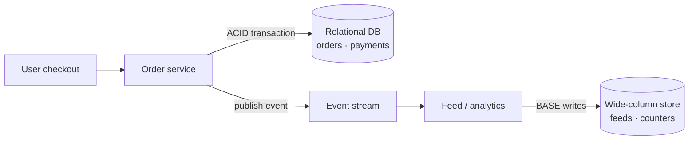

ACID and BASE are two philosophies for handling data. ACID puts correctness first. BASE puts availability and scale first. Most real systems use both, for different data.

## ACID: strict and reliable

ACID describes how traditional relational database transactions behave:

- **Atomicity:** a transaction happens completely or not at all. No half-transferred money.
- **Consistency:** each transaction moves the database from one valid state to another, respecting constraints, foreign keys and invariants.
- **Isolation:** concurrent transactions don't see each other's partial work. The result is as if they ran one at a time.
- **Durability:** once committed, data survives crashes, usually thanks to a [write-ahead log](/system-design/write-ahead-logging-wal/).

ACID fits anywhere a mistake is expensive: payments, banking, inventory, bookings.

## BASE: available and eventually right

BASE describes many large distributed databases:

- **Basically Available:** the system keeps responding, even during partial failures.
- **Soft state:** data on a node may change over time without new input, as replicas sync.
- **Eventual consistency:** if writes stop, all replicas eventually converge to the same value.

BASE systems may show temporary inconsistencies, such as a like count that differs between two refreshes, but they fix themselves over time.

## Comparison

| | ACID | BASE |
| --- | --- | --- |
| Priority | Correctness | Availability and scale |
| Consistency | Immediate | [Eventual](/system-design/strong-vs-eventual-consistency/) |
| Scaling | Mostly vertical, harder to distribute | Horizontal by design |
| Typical stores | PostgreSQL, MySQL, Oracle | Cassandra, DynamoDB, Riak |
| Failure behaviour | Rejects or blocks | Serves possibly stale data |

## Using both in one architecture

The core money flow stays ACID. Everything derived from it (recommendations, activity feeds, analytics dashboards) goes through an event stream into BASE stores that scale cheaply and tolerate a little lag.

## In interviews

Avoid picking one camp for the whole system. Split by data: "Orders and payments live in Postgres with ACID transactions. View counts and the feed live in Cassandra, where eventual consistency is fine." Across services, where a single ACID transaction isn't possible, reach for the [SAGA pattern](/system-design/distributed-transactions-saga-pattern/).
