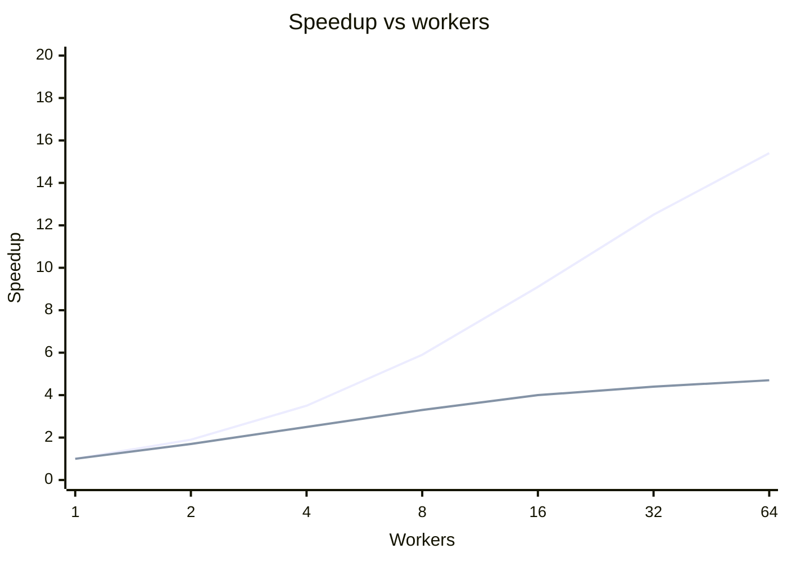
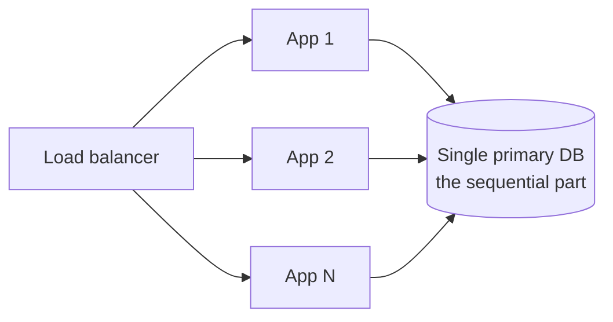

Amdahl's Law says that **the speedup you get from parallelization is limited by the part of the work that must stay sequential.**

## The formula

If a fraction $p$ of the work can run in parallel and you spread it over $N$ workers, the best possible speedup is:

$$S(N) = \frac{1}{(1 - p) + \dfrac{p}{N}}$$

As $N$ grows towards infinity, the parallel part shrinks to nothing and you're left with:

$$S_{max} = \frac{1}{1 - p}$$

So if 20% of the work is always sequential ($p = 0.8$), the maximum speedup is $1 / 0.2 = 5\times$. That holds whether you add 10 machines or 10,000.

The solid line is 95% parallel work, the dashed line 80%. Both flatten out, and the dashed one barely moves past 8 workers.

## What it looks like in a real system

The sequential part is usually a shared resource that every request must touch:

- a single primary database that handles all writes
- a global lock or a single-threaded coordinator
- a central ID generator or counter
- one slow downstream dependency called on every request

You can add a hundred app servers, but if each request needs a write on the one primary, that primary caps your throughput.

## What to do about it

- **Find the bottleneck first.** Profile and trace before scaling. See [distributed tracing](/system-design/distributed-tracing/).
- **Shrink the sequential part:** [shard](/system-design/database-sharding/) the database, add [read replicas](/system-design/replication-patterns-master-slave-master-master/), cache hot reads, replace global locks with per-key locks.
- **Move work off the critical path:** do non-essential steps asynchronously through a [queue](/system-design/message-queues/).

## In interviews

When someone says "just add more servers," Amdahl's Law is your answer: "That only helps the parallel part. The single write primary is our sequential bottleneck, so I'd shard by user ID first."
