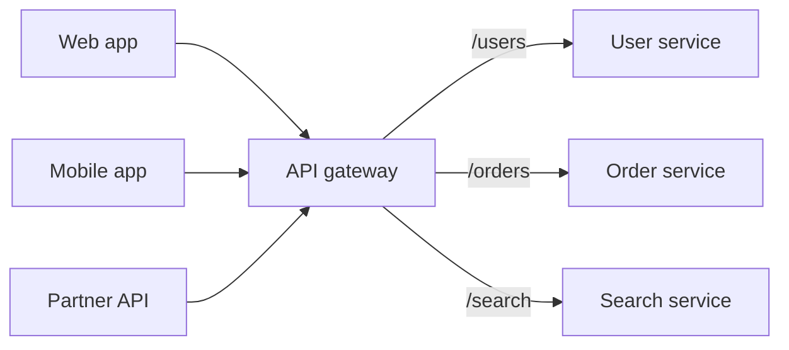
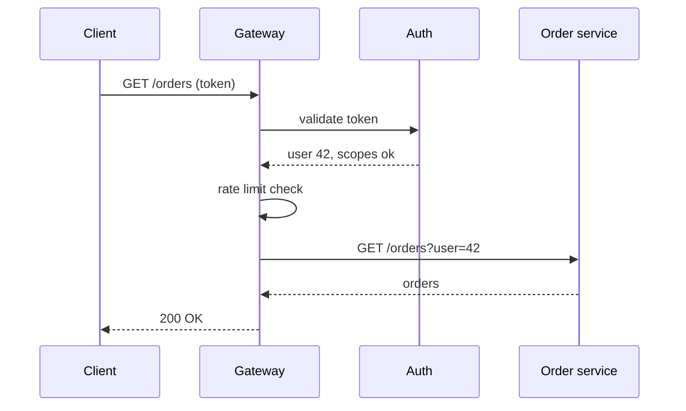

An API gateway is a specialised [reverse proxy](/system-design/forward-proxy-vs-reverse-proxy/) that acts as the single entry point for all API calls in a [microservices](/system-design/monolithic-vs-microservices-architecture/) system. Clients talk to one endpoint, and the gateway sends each request to the right service.

## What it handles

These are cross-cutting concerns you don't want to re-implement in every service:

- **Routing:** map `/orders/*` to the order service, `/users/*` to the user service.
- **Authentication:** validate tokens once at the edge. See [OAuth 2.0 and OIDC](/system-design/oauth-2-0-and-oidc/).
- **[Rate limiting](/system-design/rate-limiting/)** per user, API key or IP.
- **Logging, metrics and tracing:** start the trace ID for [distributed tracing](/system-design/distributed-tracing/).
- **TLS termination, compression, CORS.**
- **Light response shaping:** version translation, or combining a couple of calls for a mobile client.

## Request flow

## Why it helps

- **Simpler clients:** one hostname, one auth scheme, one place for API docs.
- **Freedom behind it:** split, merge or rename services without breaking clients.
- **Consistent policy:** security and limits applied in one place.

## How it goes wrong

- **Too much logic:** business rules creep into the gateway until it becomes a mini monolith that every team has to change and deploy.
- **Bottleneck and single point of failure:** every request passes through it, so it needs to be horizontally scaled and highly available.
- **Extra hop:** a little added latency on every call.

Good designs keep the gateway **focused and thin**. It handles transport and policy. Business logic stays in services.

## Backend for frontend (BFF)

When web and mobile clients need very different response shapes, a common variant is one small gateway per client type (a BFF). Each frontend team owns its BFF, so the shared gateway doesn't have to serve conflicting needs.

## Examples

Kong, AWS API Gateway, Apigee, Envoy-based gateways, and NGINX with plugins.

## In interviews

Put the gateway at the edge of a microservices diagram and list three jobs: "auth, rate limiting and routing." Then add: "It stays thin, with no business logic," which is the sign of experience interviewers listen for.
