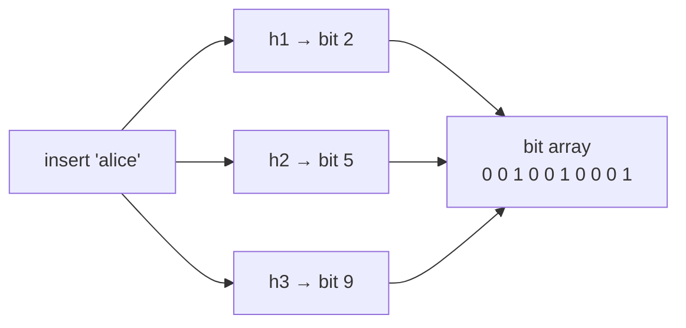
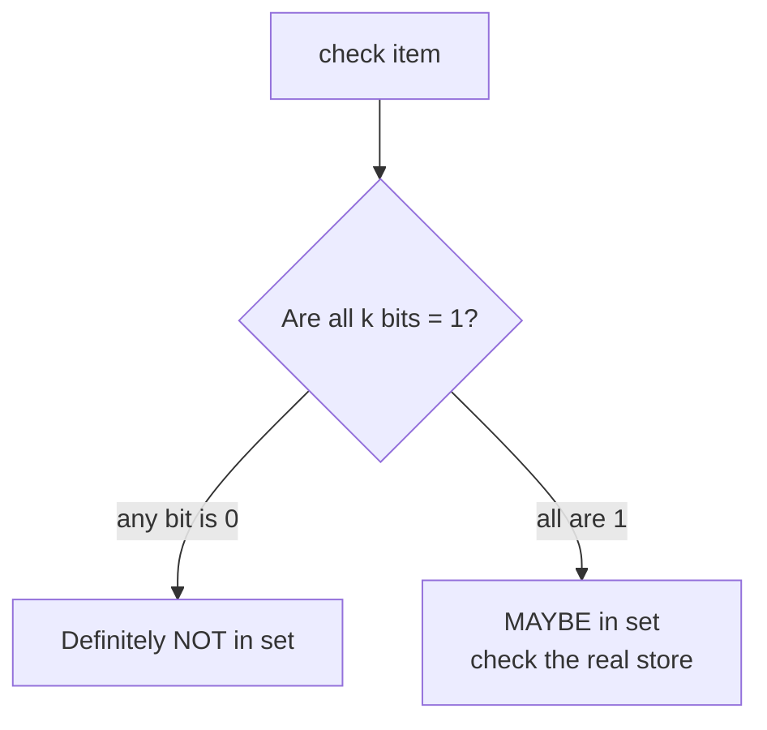

A Bloom filter is a space-efficient data structure that quickly answers **"might this item be in the set?"** It can give false positives ("maybe" when the answer is no) but **never false negatives** (it never says "no" for an item that was added).

Think of it as a fast gatekeeper that says either **definitely not** or **maybe**.

## How it works

Start with a bit array of $m$ bits, all zero, and $k$ independent hash functions.

**Insert** an item: hash it with all $k$ functions and set those $k$ bits to 1.

**Check** an item: hash it the same way and look at those $k$ bits.

If any bit is 0, the item was never inserted, guaranteed. If all are 1, either it was inserted or other items happened to set those same bits. That's a false positive.

## Tuning the false positive rate

For $n$ inserted items, the false positive rate is approximately:

$$p \approx \left(1 - e^{-kn/m}\right)^k$$

In practice, about **10 bits per item** with 7 hash functions gives roughly a **1% false positive rate**, whatever the size of the items themselves. A million URLs take about 1.2 MB instead of tens of megabytes.

## Limitations

- **No deletion** in the basic version. Clearing a bit might erase other items. Counting Bloom filters and cuckoo filters support deletes.
- **It can't list its contents.** It only answers membership questions.
- **It fills up.** Past its designed capacity, the false positive rate climbs, so size it for growth.

## Where it's used

- **LSM-tree databases** (Cassandra, RocksDB, HBase): each on-disk file has a Bloom filter, so reads skip files that definitely don't contain the key. See [database indexing](/system-design/database-indexing-b-trees-lsm-trees/).
- **Caches:** avoid looking up keys that were never stored, and shield the database from requests for non-existent keys.
- **Web crawlers:** "have I already crawled this URL?"
- **Username availability, spam and malicious-URL checks:** fast pre-check before the expensive lookup.

## In interviews

Use it whenever you need a cheap "definitely not" check in front of an expensive lookup: "Before hitting the database for a username, check a Bloom filter. Most taken names are rejected in memory, and a 'maybe' falls through to the real check."
