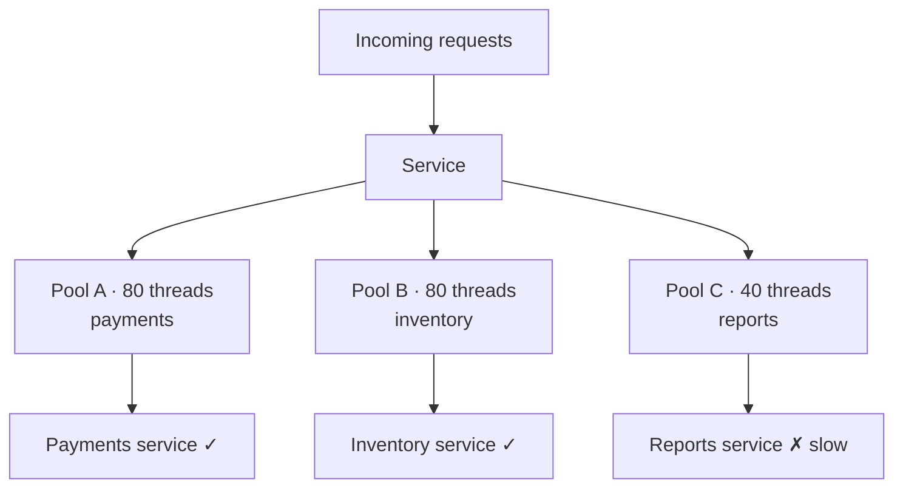

The bulkhead pattern **isolates parts of a system so a failure in one area does not sink everything**. The name comes from ships, which are split into watertight compartments (bulkheads) so a breach floods one compartment instead of the whole hull.

## The problem

A service has one shared pool of 200 threads, used for calls to three dependencies. One dependency, say a slow reporting service, starts hanging. Requests to it hold threads until all 200 are stuck waiting. Now calls to the other two healthy dependencies can't get a thread either, and the whole service is down because of one slow neighbour.

## The fix: separate compartments

When the reports service hangs, only pool C fills up. Calls to reports fail fast once their pool is exhausted, while payments and inventory keep working normally.

## Levels of bulkheads

- **Thread or connection pools** per dependency inside one service. The most common form.
- **Semaphores:** cap concurrent calls to a dependency without separate threads.
- **Separate queues or workers** per job type, so a flood of bulk exports can't delay password-reset emails.
- **Separate service instances or clusters** per feature or customer tier. For example, premium customers get a dedicated cluster.
- **Cell-based architecture:** split the whole system into independent cells, each serving a slice of users. An outage hits one cell's users, not everyone.

## Sizing them

- Base pool sizes on each dependency's expected concurrency (throughput × latency, see [Little's Law](/system-design/latency-and-throughput/)), plus headroom.
- Give critical paths (checkout, login) more capacity than nice-to-haves.
- Reject quickly when a bulkhead is full rather than queueing indefinitely.

The trade-off is some wasted capacity: idle threads in one pool can't help a busy pool. That's the price of containment.

## Works well with

- **[Circuit breakers](/system-design/circuit-breaker-pattern/):** bulkheads limit the damage while a dependency is slow, and breakers stop calling it once it's clearly failing.
- **Timeouts:** so threads in a bulkhead get released instead of hanging forever.
- **[Rate limiting](/system-design/rate-limiting/):** stops one client from filling a shared compartment.

## In interviews

Bulkheads show you're thinking about **fault isolation and blast radius**: "Each downstream dependency gets its own connection pool, and background jobs run on separate workers, so a slow reports service or an export flood can't starve checkout."
