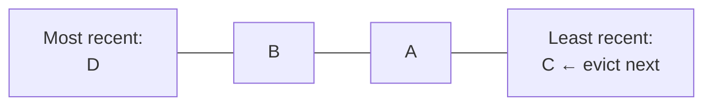

Cache memory is limited. When the cache is full and a new item arrives, an **eviction policy** decides which existing item to remove. The goal is to keep the most valuable items in memory, the ones most likely to be requested again.

## LRU: least recently used

Evict the item that **hasn't been accessed for the longest time**. The assumption: items used recently will probably be used again soon (temporal locality).

Access B and it moves to the front. Insert E into a full cache and C, at the back, is evicted.

**How it's built:** a hash map for $O(1)$ lookup, plus a doubly linked list ordered by recency. On every access, move the node to the head. To evict, remove the tail. Both are $O(1)$, which makes this a classic interview coding question.

**Weakness:** one big scan of rarely used items, like a batch job reading every product once, can flush out the genuinely hot data.

## LFU: least frequently used

Evict the item with the **fewest accesses**. This favours long-term popularity: a product page viewed 10,000 times survives even if it wasn't touched in the last minute.

**Weaknesses:** items that were popular long ago can linger forever unless counts decay over time, and new items are evicted before they get a chance to build up a count.

## Others

- **FIFO:** evict the oldest *inserted* item, regardless of use. Simple, but often evicts hot data.
- **Random:** evict a random item. Surprisingly decent, and very cheap with no bookkeeping.
- **TTL-based:** items expire after a fixed time. This is about freshness more than space, and is usually combined with LRU or LFU.
- **Advanced:** ARC, 2Q, W-TinyLFU (used by Caffeine) and SLRU blend recency and frequency to resist scans and adapt to the workload.

## Comparison

| Policy | Keeps | Good for | Weakness |
| --- | --- | --- | --- |
| LRU | Recently used | Most general workloads | One-off scans flush hot data |
| LFU | Frequently used | Stable popularity (top products) | Slow to adapt, stale favourites |
| FIFO | Newest inserts | Simple, time-ordered data | Ignores usage entirely |
| Random | Anything | Very cheap, large caches | Unpredictable |
| W-TinyLFU / ARC | Both | High-performance caches | More complex |

## In practice

Redis lets you choose with `maxmemory-policy`. Common choices are `allkeys-lru`, `allkeys-lfu`, or `volatile-*` variants that only evict keys with a TTL. Redis uses *approximated* LRU and LFU, sampling a few keys rather than maintaining an exact list, to save memory.

Watch the **eviction rate** and **hit ratio**. Frequent evictions of still-useful keys mean the cache is too small for its working set.

## In interviews

"LRU by default. If a few keys are consistently hot, like trending products, LFU keeps them resident. Either way, TTLs handle freshness separately from eviction." See also [caching in system design](/system-design/caching-in-system-design/).
