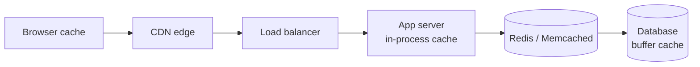

Caching stores frequently accessed data in a **fast storage layer**, usually memory, so you don't recompute it or fetch it from a slower system every time. It cuts latency and reduces load on the backend.

Reading from RAM takes around 100 nanoseconds. A database query over the network often takes milliseconds. A cache hit can be **10 to 100 times faster** than the original lookup.

## Cache layers

A single request may pass through several caches before reaching the database:

| Layer | Example | Good for |
| --- | --- | --- |
| Client / browser | HTTP cache, service worker | Static assets, repeat visits |
| [CDN](/system-design/content-delivery-network-cdn/) | Cloudflare, CloudFront | Images, JS, public pages |
| In-process | A map or LRU inside the app | Tiny, very hot data, config |
| External key-value | [Redis](/system-design/intro-to-redis/), Memcached | Sessions, query results, computed views |
| Database | Buffer pool, query cache | Recently read pages |

In-process caches are the fastest but aren't shared between servers. External caches are shared and survive app restarts, but they add a network hop. See [distributed cache](/system-design/distributed-cache/).

## What to cache

Caching works best for:

- **Read-heavy data:** read far more often than it's written (product pages, profiles).
- **Expensive computations:** aggregations, rendered pages, ML results, external API calls.
- **Data that tolerates slight staleness:** a counter that's a few seconds behind is fine.

Avoid caching data that changes on every request, data that must always be perfectly fresh (balances at payment time), or data so rarely read that it would just take up memory.

## Measuring it

The key metric is the **hit ratio**: hits ÷ (hits + misses). The average latency is:

$$T_{avg} = h \cdot T_{cache} + (1 - h) \cdot T_{db}$$

With a 95% hit ratio, a 1 ms cache and a 20 ms database, the average is about 2 ms instead of 20 ms.

## Why caching is harder than it looks

- **Invalidation:** when the source changes, cached copies become stale. You need TTLs, explicit deletes on write, or events. As the saying goes, cache invalidation is one of the two hard problems in computer science.
- **Consistency:** the cache and the database can briefly disagree. See [caching strategies](/system-design/caching-strategies-cache-aside-write-through-etc/).
- **Cache stampede:** a hot key expires and thousands of requests hit the database at once. Fixes: request coalescing (only one request refreshes), locks, and adding random jitter to TTLs.
- **Cold starts:** an empty cache after a restart sends all traffic to the database. See [cold and warm cache](/system-design/cold-and-warm-cache-in-system-design/).
- **Limited memory:** you need an [eviction policy](/system-design/cache-eviction-policies/).

## In interviews

Add a cache when the read path is hot, and say exactly what is cached, the key, the TTL and how it's invalidated: "Product pages are cached in Redis by product ID with a 10-minute TTL, and deleted on update."
