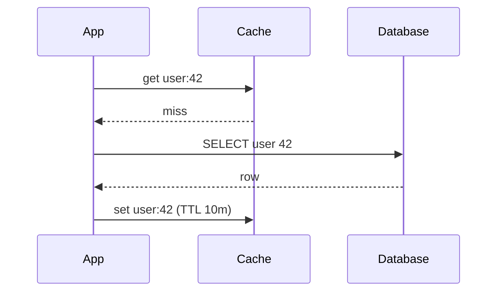
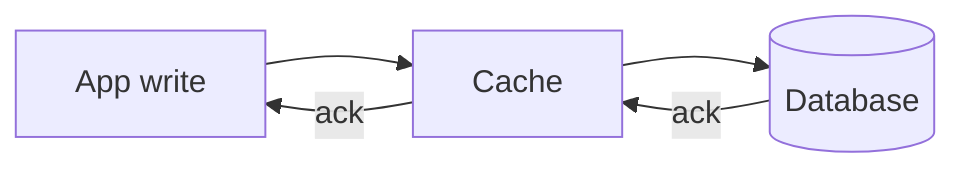
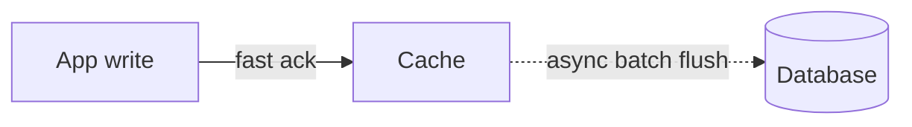

A caching strategy decides **who reads and writes the cache, and when**. Each balances freshness, complexity and performance differently.

## Cache-aside (lazy loading)

The application manages the cache itself. It checks the cache first, and on a miss loads from the database and fills the cache.

On writes, the app updates the database and **deletes** the cache key, so the next read reloads fresh data.

- **Good:** only requested data gets cached, and if the cache is down, reads still work (slower).
- **Bad:** the first read of each key is a miss, and there's a small window where stale data can be cached.

This is the most common strategy, and the default answer in interviews.

## Read-through

Same idea, but the **cache itself** loads from the database on a miss. The app only talks to the cache. That keeps app code cleaner, but needs a cache that supports loaders.

## Write-through

Every write goes to the cache and the database **at the same time**. The write is only acknowledged once both are updated.

- **Good:** the cache always matches the source, so reads are always fresh.
- **Bad:** slower writes, and you cache data that may never be read.

## Write-back (write-behind)

Writes go to the **cache first** and are acknowledged immediately. The cache flushes them to the database later, often in batches.

- **Good:** very fast writes, and many updates to the same key collapse into one database write.
- **Bad:** **risky**. If the cache node dies before flushing, those writes are lost. Use it only where some loss is acceptable, or with a replicated, durable cache.

Fits counters, view tracking and metrics.

## Write-around

Writes go straight to the database and **skip the cache**. Data enters the cache only when it's read (usually with cache-aside). Good when written data is rarely read soon after, such as logs or bulk imports.

## Comparison

| Strategy | Read freshness | Write speed | Data-loss risk | Best for |
| --- | --- | --- | --- | --- |
| Cache-aside | Good, via TTL and delete | Normal | None | General read-heavy apps |
| Read-through | Good | Normal | None | Same, with simpler app code |
| Write-through | Always fresh | Slower | None | Read-after-write critical data |
| Write-back | Fresh in cache | Fastest | **Yes** | Counters, high write volume |
| Write-around | Miss after write | Normal | None | Write-once, read-rarely data |

## In interviews

Interviewers love it when you name the strategy for the scenario: "Profiles use cache-aside with delete-on-update. View counts use write-back: we increment in Redis and flush to the database every few seconds, and losing a few views on a crash is acceptable." See also [caching in system design](/system-design/caching-in-system-design/).
