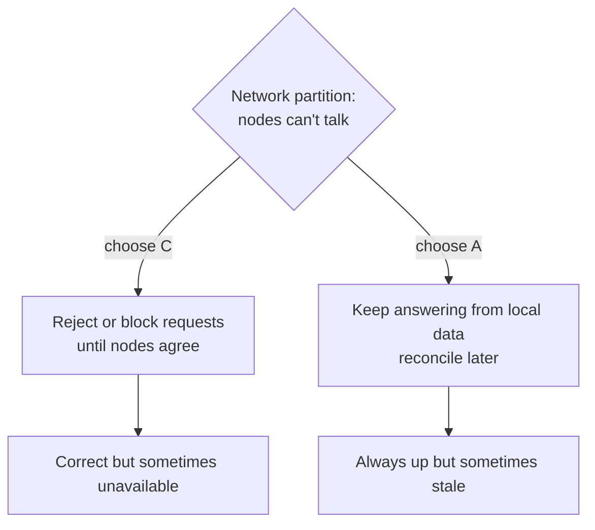

The CAP theorem says that **when a network partition happens, a distributed system has to choose between consistency and availability**. It cannot guarantee both at the same moment.

## The three letters

- **Consistency (C):** every read sees the most recent write. All users see the same data at the same time.
- **Availability (A):** every request to a working node gets a response, even if that data might be slightly stale.
- **Partition tolerance (P):** the system keeps operating even when messages between nodes are lost or delayed.

## Why it's really "C or A"

In any system spread across more than one machine, networks *will* fail. Partitions are not optional, so P is a given. The real decision is what happens when one occurs.

Picture two replicas of a bank balance that lose contact. A user writes to replica 1. Replica 2 can either refuse reads until it hears from replica 1 (consistent, unavailable) or return the old balance (available, inconsistent). There is no third option while the link is down.

## CP vs AP in practice

| Choose | Behaviour during partition | Good fit | Examples |
| --- | --- | --- | --- |
| CP | Some requests fail or wait | Payments, inventory, locks, leader election | ZooKeeper, etcd, HBase |
| AP | Every node answers, data may diverge | Feeds, carts, likes, DNS | Cassandra, DynamoDB (default), CouchDB |

Many databases let you tune this per request, for example with quorum reads and writes in Cassandra.

## Common misconceptions

- **"Pick two of three"** is misleading. You never get to drop P in a real distributed system.
- **CAP only talks about partitions.** It says nothing about the normal case. That gap is exactly what the [PACELC theorem](/system-design/pacelc-theorem/) fills.
- **Consistency in CAP is not the C in ACID.** CAP's C means linearizability (latest write visible everywhere). ACID's C means a transaction keeps the database's rules valid. See [ACID vs BASE](/system-design/acid-vs-base/).

## In interviews

Decide per feature, not per system. "Account balances are CP, so we reject writes we can't replicate. The activity feed is AP, so we serve stale data and let it [converge](/system-design/strong-vs-eventual-consistency/)." That's the answer interviewers want to hear.
