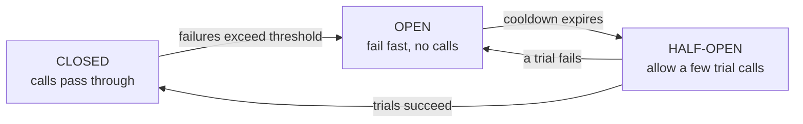

A circuit breaker wraps calls to a remote service and **stops calling it when it keeps failing**. Instead of waiting on timeouts again and again, callers fail fast, and the struggling service gets room to recover.

The name comes from electrical circuit breakers, which cut the current when something goes wrong to stop a fire.

## The problem it solves

Imagine the payment service slows down. Every checkout request now waits 30 seconds on a timeout. Threads and connections pile up in the checkout service until it runs out of resources and fails too. Then everything calling checkout fails. That's a **cascading failure**: one slow dependency drags down the whole system.

## The three states

- **Closed:** normal operation. Calls go through, and the breaker counts failures and timeouts.
- **Open:** after too many failures (for example 50% of calls in the last 10 seconds), the breaker trips. New calls fail **immediately** without touching the remote service.
- **Half-open:** after a cooldown (say 30 seconds), a few trial requests are let through. If they succeed, the breaker closes. If they fail, it opens again.

## What to do when the circuit is open

Failing fast is only half the story. Give the user something useful:

- **Fallbacks:** show cached recommendations, a default value, or "prices may be outdated."
- **Graceful degradation:** hide a non-critical widget instead of failing the whole page.
- **Queue for later:** accept the order and process the payment when the service recovers.

## Tuning

Circuit breakers have to be tuned carefully:

- **Too sensitive:** a couple of errors open the circuit, and you cause the outage yourself.
- **Too lax:** it opens long after the damage is done.

Typical knobs: a minimum number of calls before judging, a failure-rate threshold, a slow-call threshold (count slow calls as failures), the cooldown length and the number of half-open trial calls.

## Works well with

- **Timeouts:** always set them. A breaker can't help if calls hang forever.
- **[Retries with backoff](/system-design/retry-patterns-and-exponential-backoff/):** retries handle brief blips, and the breaker stops retries when the service is truly down.
- **[Bulkheads](/system-design/bulkhead-pattern/):** limit how many resources a failing dependency can tie up.

Libraries: Resilience4j (Java), Polly (.NET), opossum (Node.js). Service meshes such as Istio and Envoy provide breakers at the network level.

## In interviews

When one service calls another, add: "Calls to payments go through a circuit breaker with timeouts. If it opens, we queue the order and confirm payment asynchronously, so a payments outage doesn't take down checkout."
