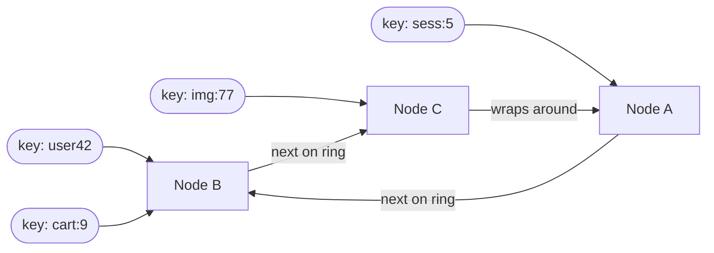
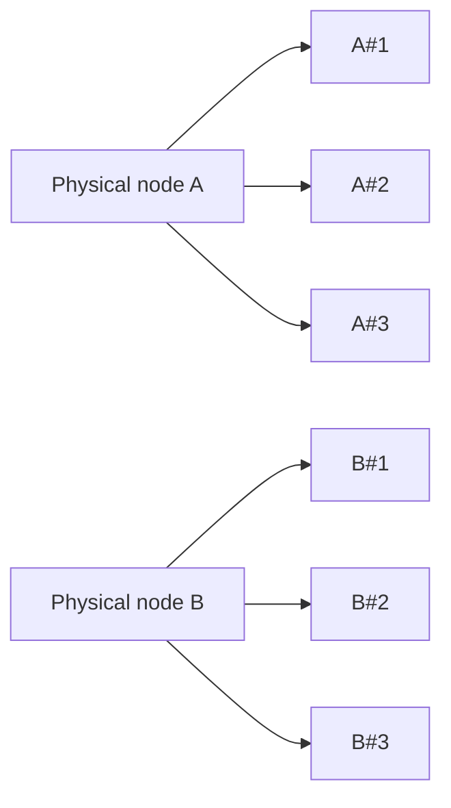

Consistent hashing distributes keys across nodes so that **adding or removing a node only moves a small share of keys**. It's the backbone of distributed caches and databases.

## The problem with `hash mod N`

The simple approach is $\text{node} = \text{hash}(\text{key}) \bmod N$. It spreads keys evenly, until $N$ changes.

Going from 4 nodes to 5 changes the result for about 80% of keys. In a cache, that's a sudden wave of misses that can flatten your database. In a database, it's a massive data migration.

## The hash ring

Consistent hashing places **both nodes and keys** on the same circular hash space (say $0$ to $2^{32} - 1$). Each key belongs to the **first node clockwise** from its position.

## Adding and removing nodes

- **Add node D** between A and B: only the keys between A and D move, from B to D. Everything else stays put.
- **Remove node B:** only B's keys move, to the next node clockwise (C).

On average only $1/N$ of keys move when the cluster changes, instead of nearly all of them.

## Virtual nodes

With few physical nodes, positions on the ring can be uneven, so one node ends up owning a huge arc. The fix is **virtual nodes**: each physical node is placed on the ring many times (for example 100 to 200 positions), using different hashes.

This gives:

- **Even distribution,** because many small arcs average out.
- **Smooth rebalancing:** when a node leaves, its load spreads over many nodes instead of dumping onto one neighbour.
- **Weighting:** give a bigger machine more virtual nodes.

## Where it's used

- **Distributed caches:** Memcached client libraries, [Redis Cluster](/system-design/intro-to-redis/) (which uses a related idea, fixed hash slots).
- **Databases:** Cassandra and DynamoDB partition data on a ring.
- **Load balancers and CDNs:** route the same key to the same backend for cache locality.

## In interviews

Whenever you shard or cache across nodes, say: "Keys are placed with consistent hashing and virtual nodes, so scaling the cluster only moves about $1/N$ of the data." Think of it as a smooth mapping that doesn't get scrambled when the cluster size changes.
