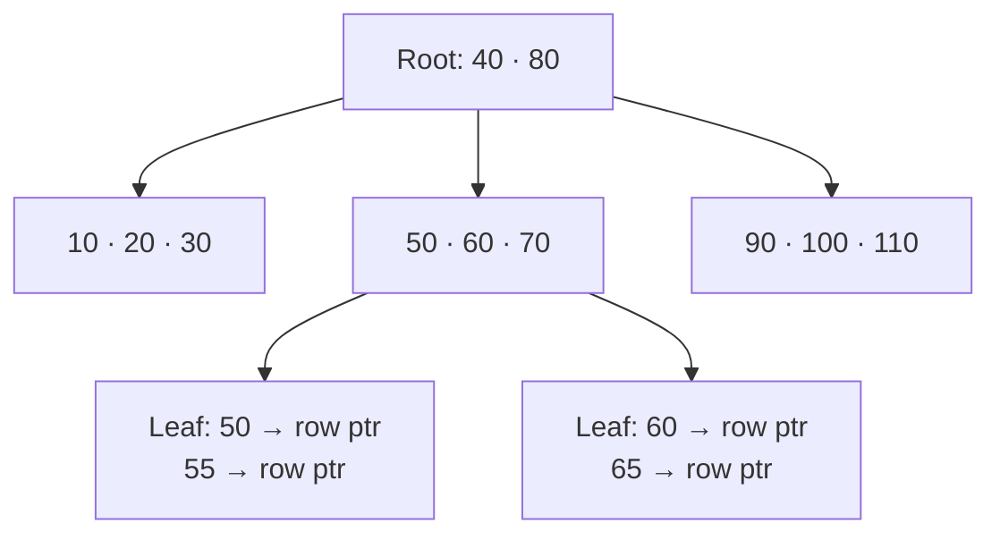
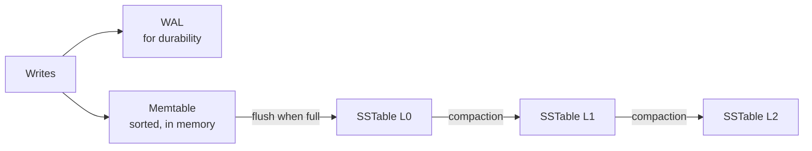

Without an index, finding a row means scanning the whole table. An index is a **separate data structure** that organises keys so the database can jump straight to the rows it needs, like the index at the back of a book.

## B-trees: the read-friendly default

A B-tree is a balanced tree whose nodes are disk pages holding many sorted keys. Every lookup walks from the root to a leaf, and because each node has hundreds of children, the tree stays very shallow.

- **Point lookups** take $O(\log n)$ page reads. A billion rows is only about 4 levels deep.
- **Range queries** are efficient because the leaves are sorted and linked: `WHERE price BETWEEN 50 AND 70`.
- **Writes update pages in place,** which means random disk I/O.

Used by PostgreSQL, MySQL (InnoDB), SQL Server, Oracle, and most relational databases.

## LSM trees: the write-friendly alternative

A Log-Structured Merge tree never updates in place. It batches writes in memory and flushes them to disk as sorted, immutable files.

1. Writes go to an in-memory **memtable** (plus a [write-ahead log](/system-design/write-ahead-logging-wal/) for crash safety).
2. When full, the memtable is flushed as a sorted file (**SSTable**).
3. Background **compaction** merges files and drops overwritten or deleted values.

- **Writes are very fast:** sequential appends only.
- **Reads are more complex:** a key might be in the memtable or any of several SSTables. [Bloom filters](/system-design/bloom-filters/) on each file skip files that definitely don't contain the key.

Used by Cassandra, RocksDB, LevelDB, HBase and ScyllaDB.

## Trade-off

| | B-tree | LSM tree |
| --- | --- | --- |
| Write speed | Moderate, random I/O | Very high, sequential I/O |
| Read speed | Fast, predictable | Good, can check several files |
| Range scans | Excellent | Good |
| Background work | Little | Compaction uses CPU and I/O |
| Best for | Read-heavy, transactional | Write-heavy: logs, events, time series |

## Every index has a price

An index is a second structure that **must be updated on every write**. A table with 8 indexes does roughly 9 writes per insert. Too many indexes hurt insert performance and use more storage.

Practical rules:

- Index columns you filter, join or sort on often.
- Use **composite indexes** in the order of your queries: an index on `(user_id, created_at)` serves "this user's latest orders."
- Drop indexes nothing uses.
- Check query plans (`EXPLAIN`) instead of guessing.

## In interviews

Mention the write-heavy versus read-heavy trade-off: "The event log is write-heavy, so an LSM-based store like Cassandra. The orders table is read-heavy with range queries, so Postgres with a B-tree index on `(user_id, created_at)`."
