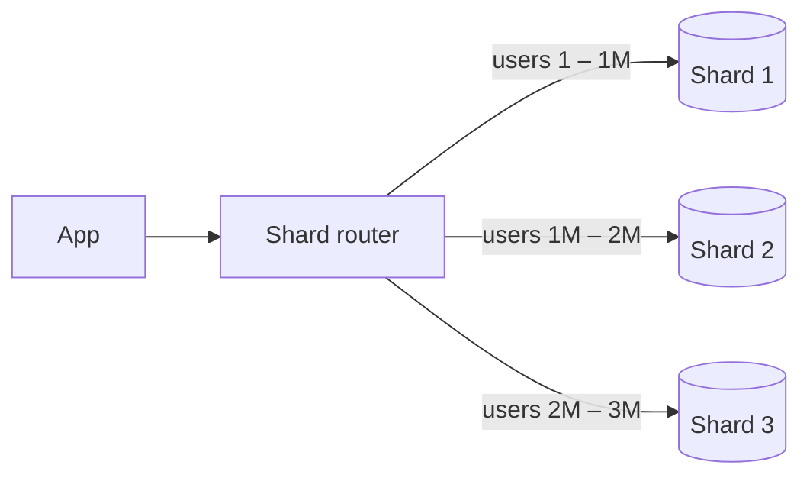

Sharding splits a dataset across multiple database machines. Each machine (a **shard**) holds a subset of the rows, and together they hold everything. The goal is to scale storage and write throughput past what any single node can handle.

[Replication](/system-design/replication-patterns-master-slave-master-master/) copies the *same* data to more machines, which helps reads and availability. Sharding splits *different* data across machines, which helps writes and storage. Big systems use both: every shard is itself replicated.

## Sharding strategies

### Range-based

Assign contiguous key ranges to shards: user IDs 1 to 1M on shard 1, and so on. Or by date, by alphabet, by region.

- **Good:** range queries stay on one shard ("all orders from March").
- **Bad:** hot spots. If keys are sequential (timestamps, auto-increment IDs), every new write lands on the last shard.

### Hash-based

Compute $\text{shard} = \text{hash}(\text{key}) \bmod N$.

- **Good:** spreads load evenly and avoids sequential hot spots.
- **Bad:** range queries must hit every shard. Changing $N$ remaps almost every key, unless you use [consistent hashing](/system-design/consistent-hashing/).

### Directory-based

Keep a lookup table that maps each key (or key group) to a shard.

- **Good:** total flexibility. Move a single tenant to its own shard.
- **Bad:** the directory is an extra lookup and must itself be highly available and fast.

## Choosing a shard key

The shard key decides everything. A good one:

- has **high cardinality** (many distinct values),
- spreads **traffic evenly**, not just data,
- matches your **most common query**, so most requests touch a single shard.

Classic trap: sharding a social app by country. One country ends up holding half the users and becomes a hot shard. `user_id` is usually a better key. For multi-tenant SaaS, `tenant_id` keeps each customer's data together, but watch out for one giant tenant.

## The costs

- **Cross-shard queries:** joins and aggregations across shards are slow or must be done in the application.
- **Cross-shard transactions:** no simple ACID across shards. You need [2PC](/system-design/two-phase-commit-2pc/) or [sagas](/system-design/distributed-transactions-saga-pattern/).
- **Resharding:** when a shard fills up, moving data while serving traffic is one of the hardest operations in databases. Plan for it with many small logical shards mapped onto fewer physical machines.
- **Operational load:** backups, schema migrations and monitoring multiply by the number of shards.

## In interviews

Don't shard first. Scale vertically, add read replicas and caching, then shard when writes or data size demand it. When you do, name the key and defend it: "Shard by `user_id` with consistent hashing. Most queries are per user, and it avoids hot spots." See also [data partitioning](/system-design/data-partitioning/).
