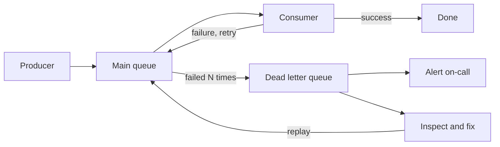

A dead letter queue (DLQ) is a separate queue that holds **messages that couldn't be processed after several attempts**. Instead of retrying them forever, the system moves them aside so the main queue keeps flowing.

Think of it as a holding area for problematic jobs.

## The problem: poison messages

Some messages will never succeed: malformed JSON, a reference to a deleted user, a bug triggered by one specific input. Without a DLQ:

- the message is retried endlessly, wasting resources,
- in ordered queues, it **blocks every message behind it**,
- the error logs fill up with the same failure.

## How it works

1. A consumer fails to process a message and doesn't acknowledge it, so it's redelivered.
2. The queue counts the attempts. After the **max receive count** (say 5), it moves the message to the DLQ instead of redelivering it again.
3. The main queue continues with the next message.
4. Engineers inspect the DLQ, fix the bug or the data, and **replay** the messages back into the main queue.

## Making it useful

- **Keep context:** store the original message along with the error, stack trace, attempt count, timestamps and source queue.
- **Alert on it:** a growing DLQ is a signal that something is broken. Alert on depth and on the age of the oldest message.
- **Retry with backoff before giving up:** transient failures should be absorbed by [retries with exponential backoff](/system-design/retry-patterns-and-exponential-backoff/). The DLQ is for messages that keep failing.
- **Classify errors:** permanent errors (validation, missing data) can go to the DLQ immediately. Transient errors deserve retries first.
- **Make replays safe:** consumers must be **[idempotent](/system-design/idempotency/)**, because a replayed message may have partially succeeded the first time.
- **Set retention:** DLQ messages should outlive your debugging window, and they need an owner who actually reviews them.

## Where you'll find it

- **Amazon SQS:** a redrive policy with `maxReceiveCount`, plus "redrive to source" for replays.
- **RabbitMQ:** dead letter exchanges.
- **Azure Service Bus:** a built-in DLQ per queue.
- **Kafka:** usually done in application code as an extra "dead letter" topic.

## In interviews

When you add a [message queue](/system-design/message-queues/), finish the story: "After 5 failed attempts with backoff, messages go to a DLQ. We alert on DLQ depth, and after fixing the cause, replay them. Consumers are idempotent, so replays are safe." It shows you've thought about what happens when things go wrong.
