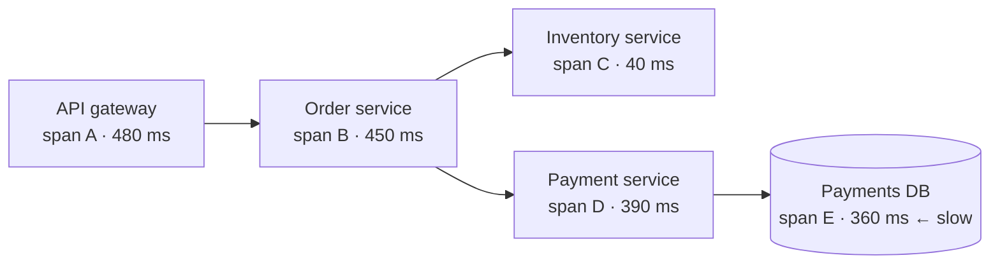
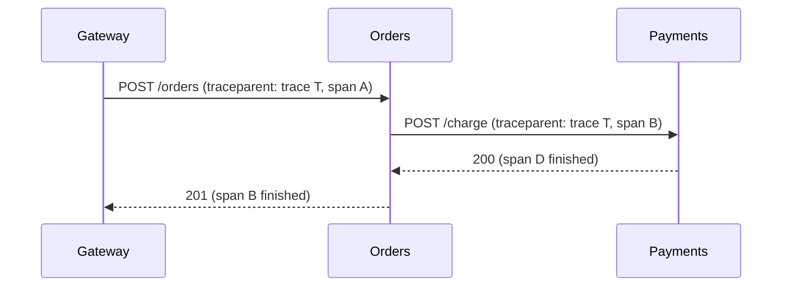

In a [microservices](/system-design/monolithic-vs-microservices-architecture/) system, one click can travel through a gateway, five services, a queue and two databases. When it's slow or fails, logs from each service only show their own piece. **Distributed tracing reconstructs the whole journey of a single request.**

Without tracing, you see errors in isolation. With it, you see the whole story across services, queues and databases.

## Traces and spans

- A **trace** is the complete path of one request, identified by a unique **trace ID**.
- A **span** is one unit of work within it, such as an HTTP call, a database query or a queue publish. Each span records a start time, a duration, a status and attributes, plus a **parent span ID**, which turns the spans into a tree.



Seen as a timeline (a "waterfall"), the culprit is obvious: 360 of the 480 ms went into one payments query.

## Context propagation

The trace only works if every hop passes the IDs along. The first service creates the trace ID, and every outgoing call carries it in headers. The W3C standard is the `traceparent` header:

```
traceparent: 00-4bf92f3577b34da6a3ce929d0e0e4736-00f067aa0ba902b7-01
             version-trace id-parent span id-flags
```



Queues need the same care: put the trace context in message headers, so the consumer's work joins the producer's trace.

## What tracing helps with

- **Latency debugging:** find which hop is slow, and whether calls run sequentially when they could run in parallel.
- **Error root cause:** see where a failure started, not just where it surfaced.
- **Dependency maps:** discover which services actually call which.
- **Linking signals:** put the trace ID in every log line, so you can jump from a trace to the exact logs.

## Sampling

Tracing every request at high traffic is expensive. Common approaches:

- **Head-based sampling:** decide at the start, for example keep 1% of traces.
- **Tail-based sampling:** decide after the trace completes, keeping all errors and slow traces plus a sample of normal ones. More useful, but it needs buffering.

## Tooling

- **OpenTelemetry:** the vendor-neutral standard for instrumentation (SDKs, auto-instrumentation, collector).
- **Backends:** Jaeger, Zipkin, Grafana Tempo, Honeycomb, Datadog, AWS X-Ray.

Tracing is one of the three pillars of observability, alongside **metrics** (is something wrong?) and **logs** (what exactly happened?). Traces answer **where** it went wrong.

## In interviews

"Every service is instrumented with OpenTelemetry. The gateway starts the trace, IDs propagate through HTTP headers and message headers, and we tail-sample to keep every error and slow trace." Mention it when you discuss debugging, SLOs or microservices.
