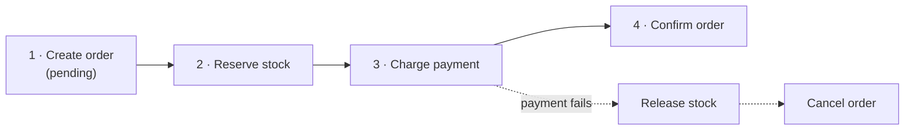
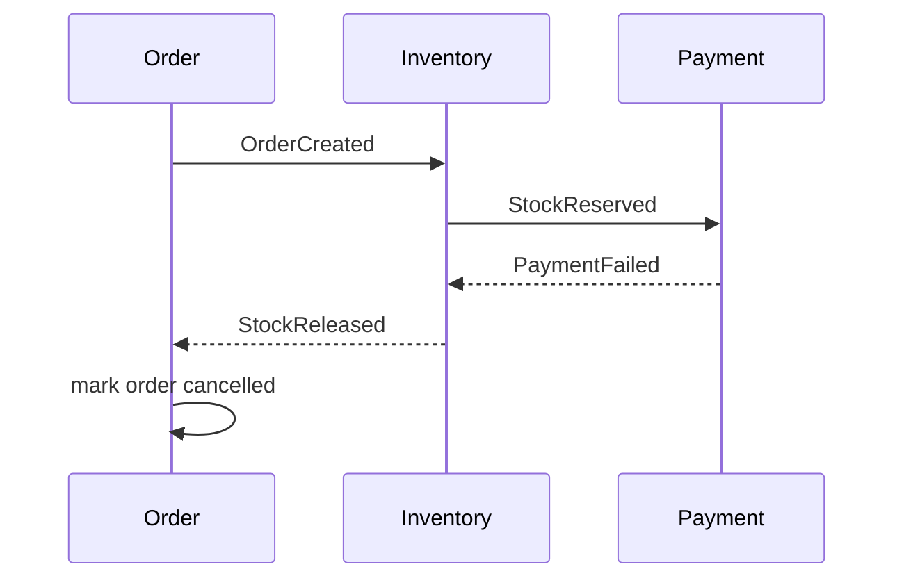
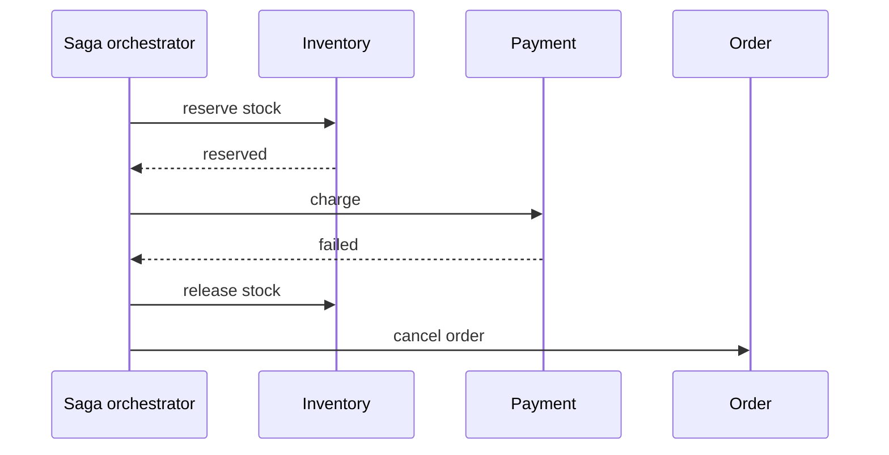

In a [microservices](/system-design/monolithic-vs-microservices-architecture/) system, placing an order might touch an order service, a payment service and an inventory service, each with its **own database**. There's no single ACID transaction that spans them all.

A **saga** models the distributed transaction as a **sequence of local transactions**. Each step commits in its own service. If a later step fails, **compensating actions** undo the earlier ones.

## A saga with compensation

- Each forward step has a matching **compensating step**: reserve stock ↔ release stock, charge ↔ refund, create order ↔ cancel order.
- Compensation is a *semantic* undo, not a rollback. A refund is a new transaction. The original charge still happened.

## Two ways to coordinate

### Choreography: services react to events

Each service performs its step and publishes an event. The next service listens and reacts. There's no central coordinator.

Simple and loosely coupled for a few steps. Hard to follow once there are many, because the flow is spread across services.

### Orchestration: a coordinator directs

A **saga orchestrator** tells each service what to do and tracks progress.

The flow is explicit and easier to monitor and change. The orchestrator is one more component to run. Workflow engines like Temporal and AWS Step Functions are often used for this.

## What you must design for

- **No isolation:** other requests can see intermediate states, such as an order that's "pending" or stock that's reserved but not paid. Model these states explicitly in the UI and data.
- **Compensations can fail too:** they must be retried until they succeed, so make them **[idempotent](/system-design/idempotency/)**.
- **Duplicate and out-of-order events:** consumers must deduplicate.
- **Reliable event publishing:** use the **outbox pattern** (write the event to an outbox table in the same local transaction, then publish it) so a service never commits without emitting its event.

## Saga vs 2PC

| | Saga | [Two-phase commit](/system-design/two-phase-commit-2pc/) |
| --- | --- | --- |
| Consistency | Eventual | Strong, atomic |
| Locking | None across services | Locks held until commit |
| Availability | High | Blocks if coordinator fails |
| Complexity | In the app (compensations) | In the protocol |
| Fits | Microservices, long-running flows | Short transactions within one system |

## In interviews

"Checkout is an orchestrated saga: reserve stock, charge, confirm. If payment fails, we release stock and cancel the order. Steps are idempotent and events go through an outbox." It fits naturally with microservices and [eventual consistency](/system-design/strong-vs-eventual-consistency/).
