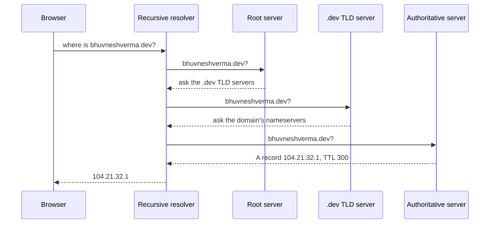

DNS maps human-readable domain names like `bhuvneshverma.dev` to IP addresses like `104.21.32.1`. Before your browser can open a connection, it has to look the address up.

## How a lookup works

1. The browser asks a **recursive resolver** (your ISP's, or a public one like 1.1.1.1 or 8.8.8.8).
2. The resolver asks a **root server**, which points to the right **top-level domain (TLD)** servers.
3. The TLD server points to the domain's **authoritative nameservers**.
4. The authoritative server returns the actual record, and the resolver hands it back.

## Caching at every layer

Every answer carries a **TTL (time to live)**. The browser, the operating system and the resolver all cache the answer until the TTL expires. That's why lookups are fast after the first one, and also why DNS changes "take time to propagate": old answers live on in caches until their TTL runs out. See [DNS caching](/system-design/dns-caching/).

**Tip:** lower the TTL a day before a planned migration, so the switch spreads in minutes instead of hours.

## Common record types

| Record | Purpose |
| --- | --- |
| A / AAAA | Name to IPv4 / IPv6 address |
| CNAME | Alias one name to another |
| MX | Mail servers for the domain |
| TXT | Verification, SPF, DKIM |
| NS | Which nameservers are authoritative |

## DNS as a load balancer

DNS can return different IPs for the same name:

- **Round-robin DNS:** rotate through several IPs.
- **GeoDNS / latency-based routing:** return the closest region's IP.
- **Failover:** stop returning an IP when its health check fails.

It's coarse, because clients cache answers and you can't control them per request, so it usually sits in front of real [load balancers](/system-design/load-balancer/) rather than replacing them.

## When DNS breaks

Many large outages have been DNS outages: an expired domain, a bad record push, or a provider going down. Your servers can be perfectly healthy and still unreachable. Use redundant DNS providers for critical domains, and be careful with automated record changes.

## In interviews

When you trace a request end to end, start with DNS: "The client resolves the domain, GeoDNS returns the nearest region, which hits that region's load balancer." It sets up the rest of the design neatly.
