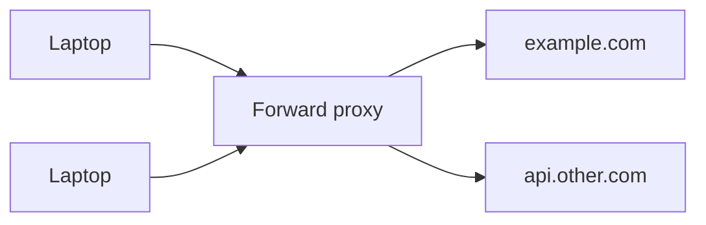
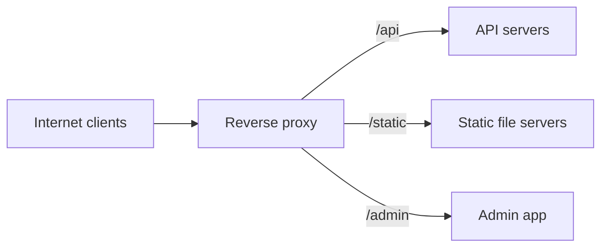

A proxy is a server that sits between two parties and forwards traffic. The difference between forward and reverse is **whose side it is on**.

## Forward proxy: represents the clients

A forward proxy sits in front of clients and represents them to the outside world. The destination server sees the proxy's IP, not the client's.

Used for:

- **Security and filtering:** companies and schools block sites or scan downloads.
- **Caching:** repeated downloads of the same file are served from the proxy.
- **Privacy and egress control:** hide client IPs, or force all outbound traffic through one audited exit.

Think of it as the gateway your laptop must pass through to reach the internet.

## Reverse proxy: represents the servers

A reverse proxy sits in front of servers and represents them to clients. The client thinks it's talking to the website. It never sees the internal machines.

Used for:

- **Hiding the internal topology:** only the proxy is exposed to the internet.
- **TLS termination:** decrypt HTTPS once at the edge. See [TLS handshake](/system-design/tls-ssl-handshake/).
- **Caching and compression** of responses.
- **Routing** by path or host to different backends.
- **Load balancing** across instances. A [load balancer](/system-design/load-balancer/) is a specialised reverse proxy.

Think of it as a company's reception desk: visitors talk to reception and never see the internal rooms.

## Side by side

| | Forward proxy | Reverse proxy |
| --- | --- | --- |
| Sits in front of | Clients | Servers |
| Hides | Client identity | Server topology |
| Configured by | Client or network admin | Service owner |
| Typical uses | Filtering, egress control, client caching | TLS, routing, load balancing, caching |
| Examples | Squid, corporate proxies | NGINX, HAProxy, Envoy, Cloudflare |

## Why it matters

Knowing the difference makes later concepts click. An [API gateway](/system-design/api-gateway/) is a reverse proxy with API features, and a [CDN](/system-design/content-delivery-network-cdn/) is a globally distributed caching reverse proxy.

## In interviews

When you draw the edge of your system, label the box: "NGINX as a reverse proxy, terminating TLS and routing `/api` to the app tier." It's one line and shows you know what the box actually does.
