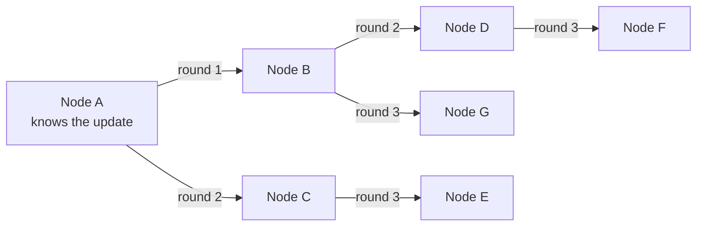

A gossip protocol lets the nodes of a distributed system share information by **periodically talking to a few random peers**. Over time, information spreads like a rumour in a social group until every node has roughly the same view.

## How it works

Every node, every second or so:

1. Picks one or a few random peers.
2. Exchanges what it knows: membership lists, health status, version numbers, config.
3. Merges the newer information into its own state.

Each round roughly doubles the number of informed nodes, so news reaches a cluster of $N$ nodes in about $O(\log N)$ rounds. A 1,000-node cluster is fully informed in about ten rounds.

## Why it's useful

- **No central authority:** no coordinator to overload or lose.
- **Fault tolerant:** if some nodes or messages fail, the information still gets through other paths.
- **Scales well:** each node does a constant amount of work per round, regardless of cluster size.
- **Handles churn:** nodes that join or leave are noticed and spread naturally.

The trade-off: gossip is **[eventually consistent](/system-design/strong-vs-eventual-consistency/)**. At any moment, two nodes may briefly disagree.

## What it's used for

- **Membership:** which nodes are in the cluster right now.
- **Failure detection:** combined with [heartbeats](/system-design/heartbeat/), for example the SWIM protocol, where nodes suspect a peer is down and confirm it through others before declaring it dead.
- **Metadata and config spread:** schema versions, token ownership on a [consistent hashing](/system-design/consistent-hashing/) ring.
- **Anti-entropy:** comparing and repairing replicas in the background.

Real examples: Apache Cassandra and Amazon's Dynamo use gossip for membership and ring state, and HashiCorp Consul and Serf use it for cluster membership and failure detection.

## Gossip vs a central registry

| | Gossip | Central coordinator (e.g. ZooKeeper) |
| --- | --- | --- |
| Consistency | Eventual | Strong |
| Single point of failure | None | Coordinator cluster must stay healthy |
| Speed of convergence | Seconds, logarithmic | Immediate |
| Best for | Large, changing clusters | Small, critical state like locks and leaders |

## In interviews

For a large distributed database or cache: "Nodes use gossip to share membership and detect failures, so there's no central coordinator to fail." For anything that needs one agreed answer, like a leader, use [consensus](/system-design/leader-election-paxos-raft/) instead.
