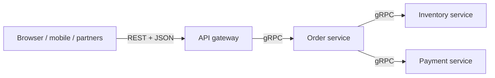

Both are ways for one program to call another over the network. They make different trade-offs between simplicity and performance.

## REST

REST models your API as **resources** with URLs, manipulated with HTTP verbs:

```
GET    /users/42          → fetch a user
POST   /orders            → create an order
PATCH  /orders/981        → update part of an order
DELETE /orders/981        → cancel it
```

Payloads are usually JSON. REST is simple, human-readable, cache-friendly (GET responses can be cached by browsers and [CDNs](/system-design/content-delivery-network-cdn/)), and works with any HTTP client, including `curl` and a browser. That's why it dominates public APIs.

## gRPC

gRPC models your API as **functions** defined in a Protocol Buffers (`.proto`) contract:

```protobuf
service OrderService {
  rpc GetOrder (GetOrderRequest) returns (Order);
  rpc TrackOrder (TrackRequest) returns (stream OrderUpdate);
}
```

From that file, gRPC generates typed client and server code in many languages. Messages are binary-encoded protobuf, smaller and faster to parse than JSON, and travel over [HTTP/2](/system-design/http-2-and-http-3-quic/) with multiplexing. It supports four call styles: unary, server streaming, client streaming and bidirectional streaming.

## Side by side

| | REST | gRPC |
| --- | --- | --- |
| Style | Resources + HTTP verbs | Remote procedure calls |
| Payload | JSON (text) | Protobuf (binary) |
| Contract | Optional (OpenAPI) | Required (`.proto`) |
| Typing | Loose | Strong, code-generated |
| Transport | HTTP/1.1 or 2 | HTTP/2 |
| Streaming | Limited | Built in, bidirectional |
| Browser support | Native | Needs gRPC-Web proxy |
| Debuggability | Easy to read | Needs tools |

## The common pattern: both



- **External clients** get REST: easy to consume, document and cache.
- **Internal service-to-service calls** use gRPC: fast, strongly typed, and contract changes are checked at compile time.

## Choosing

Use **REST** when readability, broad compatibility and caching matter, such as public APIs, webhooks and simple CRUD. Use **gRPC** when performance and contracts matter: high-volume internal calls, polyglot [microservices](/system-design/monolithic-vs-microservices-architecture/) and streaming.

## In interviews

Say where each lives: "Public API is REST behind the gateway. Services talk gRPC internally for lower latency and typed contracts." Mention that gRPC needs a proxy for browsers, which shows you know its real limits.
