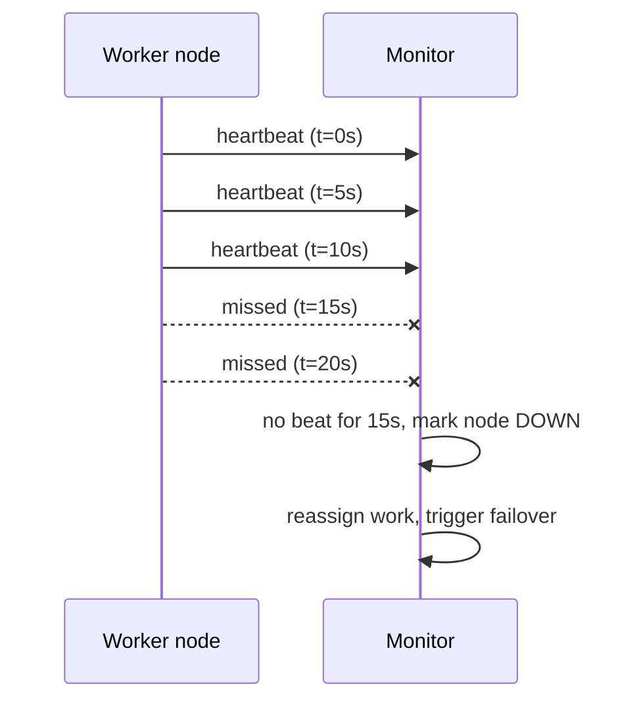

A heartbeat is a **periodic signal a node sends to say "I'm alive and healthy."** A monitor or coordinator listens for those signals. If they stop, it marks the node as down and triggers recovery. Think of it as the system's pulse check.

## How it works

Two numbers define the behaviour:

- **Interval:** how often the node sends a beat, say every 5 seconds.
- **Timeout:** how long the monitor waits before declaring the node dead. Usually several intervals, such as 3 missed beats.

## Push vs pull

- **Push (heartbeat):** the node sends beats to a monitor. Common in clusters, such as worker nodes reporting to a coordinator.
- **Pull (health check):** the monitor probes the node, for example a [load balancer](/system-design/load-balancer/) calling `GET /health`.

Both answer the same question: should this node still get traffic or work?

## Choosing the timeout

| Short timeout | Long timeout |
| --- | --- |
| Detects failures fast | Detects failures slowly |
| More false alarms from GC pauses or network blips | Fewer false alarms |
| Unnecessary failovers | Longer outages before recovery |

A missed heartbeat doesn't prove the node is dead. It might be paused by garbage collection, overloaded, or cut off by a network partition while still running. This is why systems:

- require **several missed beats** before acting,
- use **suspicion levels** (the phi accrual detector in Cassandra and Akka outputs a probability rather than yes or no),
- **confirm through other nodes** ([gossip](/system-design/gossip-protocol/)-based detectors like SWIM ask peers to probe the suspect),
- use **leases and fencing**, so a node that was declared dead but is still alive can't keep acting as leader.

## Where heartbeats are used

- **[Leader election](/system-design/leader-election-paxos-raft/):** Raft followers start an election when the leader's heartbeats stop.
- **Database failover:** promote a replica when the primary stops responding.
- **Job schedulers and workers:** reassign tasks from workers that went silent.
- **Kubernetes:** node heartbeats to the control plane, and liveness and readiness probes for containers.
- **Distributed locks and sessions:** ZooKeeper and etcd sessions expire without heartbeats, which releases the lock.

## In interviews

Heartbeats are simple but powerful for liveness detection: "Workers heartbeat every 5 seconds. After 3 missed beats the coordinator marks them dead and reassigns their jobs, and jobs are idempotent in case the worker was only slow."
