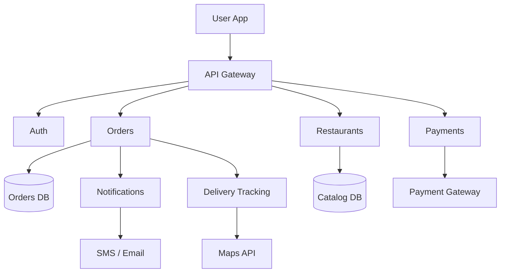

A High-Level Design (HLD) diagram is a visual overview of a system's architecture: the major components and how they interact. It shows structure and data flow, not implementation details.

## Example: Online Food Delivery System

## What the diagram must show

- **Client:** the user app or web UI that triggers every flow.
- **Services:** one box per responsibility — auth, orders, restaurants, payments, notifications, delivery. No internal logic.
- **APIs:** how the client and services talk to each other (gateway, service-to-service calls).
- **Data flow:** follow one request end to end — order placed → payment → notification → delivery update.
- **Storage:** which data lives where — users, catalog, orders, payments.
- **External systems:** payment gateway, maps/location API, SMS/email provider.
- **Infrastructure:** load balancer, servers/containers, cloud services that run and scale it.

## Before drawing

- **Scope:** know what the system must do and what is explicitly out of scope.
- **Boundaries:** list what is inside the system vs external (third-party APIs, existing services).
- **Dependencies:** note external APIs, data exchange points, and assumptions that constrain the design.
- **Tech stack:** pick language, framework, database, and hosting based on scale, cost, and team constraints — then draw boxes that match those picks.

## Steps to draw it

1. Identify the major components (client, services, storage, external systems).
2. Define how they communicate (API calls, events, data flow direction).
3. Sketch a rough layout: client at one end, gateway, services, then storage/externals.
4. Add data flow for the 1–2 most important user journeys.
5. Review with the team and update it whenever the architecture changes.

## Mistakes to avoid

- **Too much detail:** class fields, algorithms, and config belong in LLD or docs, not the HLD.
- **Inconsistent notation:** one shape per meaning, same labels everywhere.
- **Stale diagram:** an HLD that no longer matches the system is worse than none — update it as the design evolves.
