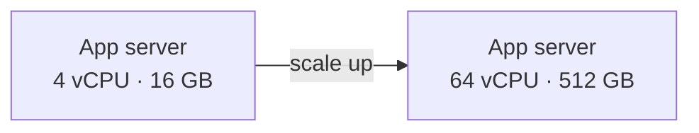
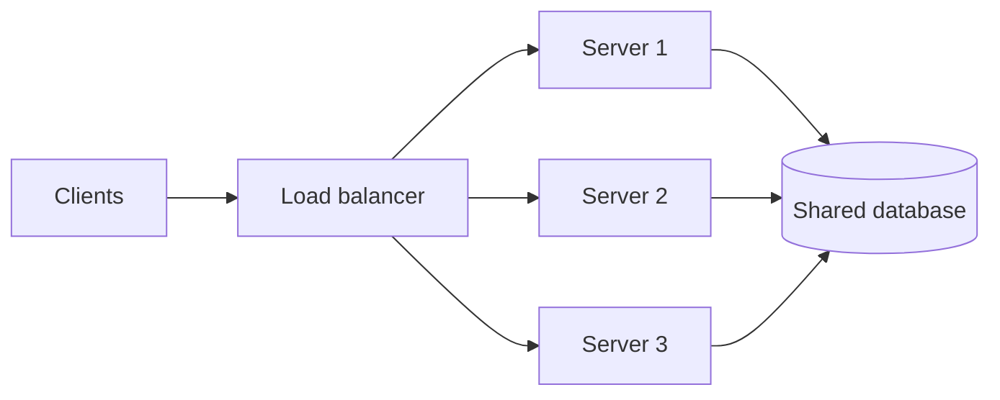

When traffic grows past what one server can handle, you have exactly two moves: make the server bigger, or add more servers. Every scaling discussion in an interview starts here.

## Vertical scaling (scale up)

Vertical scaling means upgrading a single machine: more CPU cores, more RAM, faster disks, a better network card.

- **Why it's attractive:** zero code changes. Same process, same database, same deployment, just a larger instance type.
- **Where it breaks:** hardware has a ceiling. The biggest cloud instance is finite, and price grows faster than capacity near the top of the range.
- **Hidden risk:** it is still one machine. If it goes down, everything goes down.

## Horizontal scaling (scale out)

Horizontal scaling means adding more machines and spreading the work across them.

- **Why it's attractive:** near-unlimited capacity, and losing one server only removes a slice of capacity instead of the whole service.
- **What it demands:** a [load balancer](/system-design/load-balancer/) in front, [stateless services](/system-design/stateful-vs-stateless-architecture/) so any instance can serve any request, and shared storage (database, cache, object store) for anything that must persist.

## Side by side

| | Vertical | Horizontal |
| --- | --- | --- |
| Effort to adopt | Low, resize the box | High, redesign for many nodes |
| Capacity limit | Largest available machine | Practically none |
| Failure impact | Total outage | Partial capacity loss |
| Cost curve | Steep at the top end | Roughly linear |
| Data consistency | Easy, one node | Harder, needs coordination |

## How real systems use both

Most systems scale vertically first because it is cheap in engineering time, then scale out once they hit a ceiling or need redundancy. Databases are the classic example: a primary database is often scaled up for a long time, while the stateless web tier behind a load balancer is scaled out from day one.

## In interviews

Say which tier you're scaling and why. "The API tier is stateless, so I scale it horizontally behind a load balancer. The database scales vertically first, then with [read replicas](/system-design/replication-patterns-master-slave-master-master/) and eventually [sharding](/system-design/database-sharding/)." That one sentence shows you know the trade-off.
