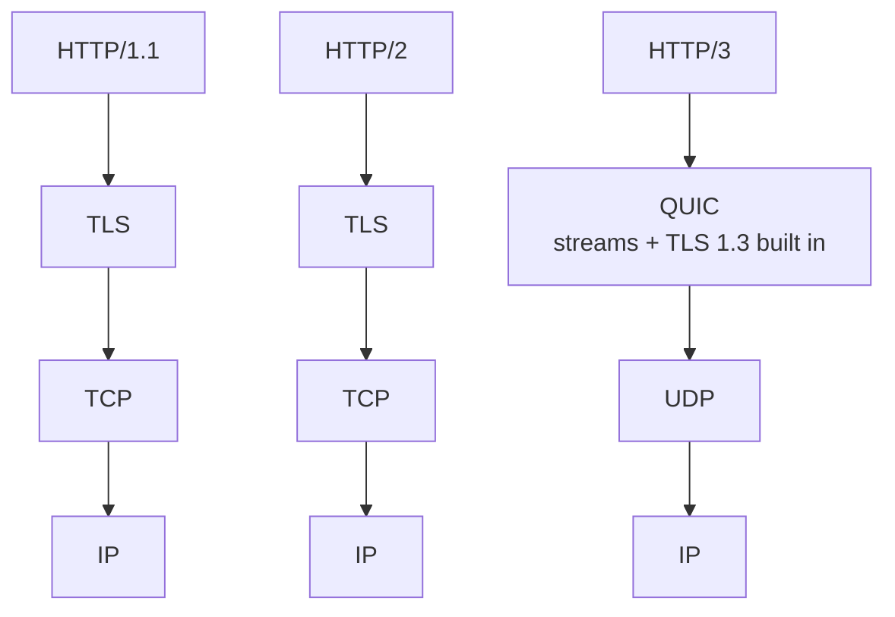

Each new HTTP version keeps the same request and response model (methods, headers, status codes) but changes how bytes travel on the wire. The goal throughout is **lower latency**.

## The problem with HTTP/1.1

HTTP/1.1 handles one request at a time per connection. Browsers worked around this by opening about 6 parallel TCP connections per domain, each with its own handshake and slow start. Pages with 100 assets still waited in line.

## HTTP/2: multiplexing on one connection

- **Multiplexing:** many requests and responses share one TCP connection as interleaved **streams**. No more waiting for the previous response.
- **Binary framing:** messages are split into binary frames instead of text, which is cheaper to parse.
- **Header compression (HPACK):** repeated headers such as cookies and user agents aren't resent in full every time.
- **Server push:** the server could send assets before they were requested. In practice it was rarely useful, and browsers have since removed support.

**The remaining problem:** it's still TCP underneath. If one packet is lost, TCP holds back *all* streams until it's retransmitted. That's TCP-level head-of-line blocking, and it hurts badly on lossy mobile networks.

## HTTP/3: HTTP over QUIC

HTTP/3 replaces TCP with **QUIC**, a transport built on [UDP](/system-design/tcp-vs-udp/).

- **Independent streams:** a lost packet only stalls its own stream, and the others keep flowing.
- **Faster setup:** QUIC combines the transport and TLS handshakes into one round trip, and resumed connections can send data immediately (0-RTT).
- **Connection migration:** connections are identified by an ID, not by IP and port, so switching from Wi-Fi to mobile data doesn't drop the connection.
- **Encryption always on:** TLS 1.3 is part of the protocol.

## Comparison

| | HTTP/1.1 | HTTP/2 | HTTP/3 |
| --- | --- | --- | --- |
| Transport | TCP | TCP | QUIC over UDP |
| Requests per connection | One at a time | Many (multiplexed) | Many (independent) |
| Head-of-line blocking | Yes | At TCP level | No |
| Header format | Text | HPACK compressed | QPACK compressed |
| Handshake cost | TCP + TLS | TCP + TLS | Combined, 1-RTT or 0-RTT |

## The takeaway

The key idea is **fewer connection setups and better use of a single connection**. HTTP/2 put everything on one connection. HTTP/3 made that connection resilient to packet loss and network changes. [gRPC](/system-design/grpc-vs-rest/) is built on HTTP/2 for exactly these reasons.

## In interviews

You rarely need to design around HTTP versions, but you can mention them as a latency win: "Serve the frontend over HTTP/3 through the CDN. It helps most for mobile users on flaky networks."
