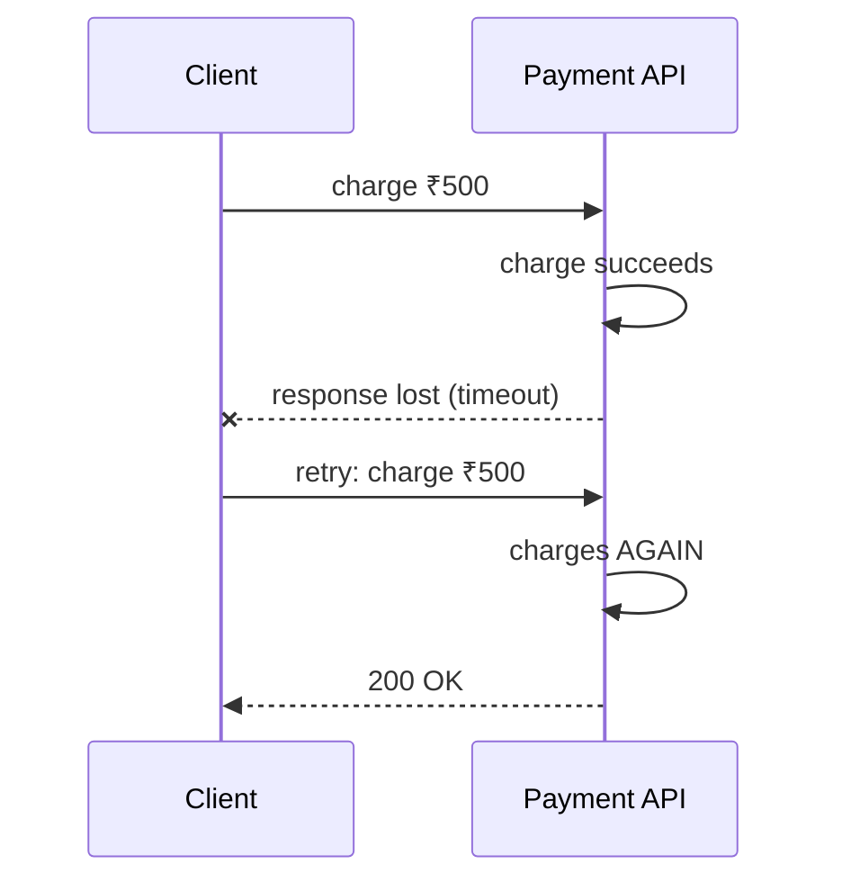
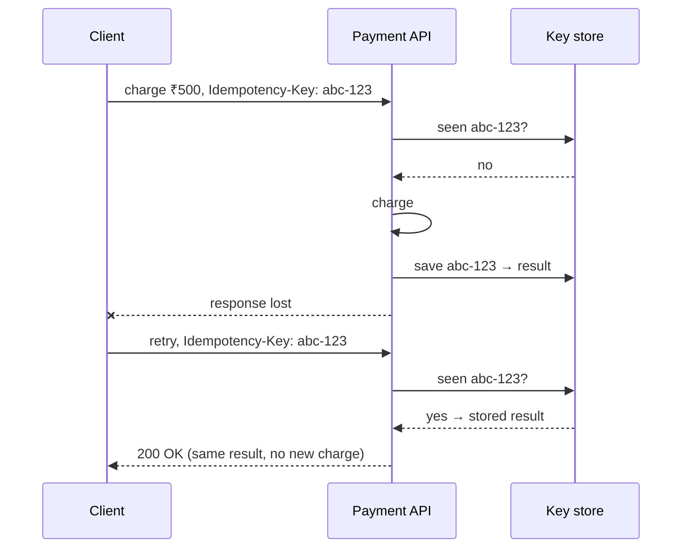

An operation is **idempotent** if performing it multiple times has the same effect as performing it once.

- "Set user status to active": idempotent. Running it twice leaves the status active.
- "Increment account balance by 10": **not** idempotent. Running it twice adds 20.

## Why it matters

Networks are unreliable, so clients [retry](/system-design/retry-patterns-and-exponential-backoff/). The dangerous case is when the request **succeeded but the response was lost**:

The client can't tell "failed" apart from "succeeded but I didn't hear back." Without idempotency, the customer is charged twice. The same problem appears with message queues, which usually offer **at-least-once delivery**: a consumer may receive the same message more than once.

## HTTP methods

| Method | Idempotent? | Why |
| --- | --- | --- |
| GET, HEAD | Yes | Reading changes nothing |
| PUT | Yes | Replaces the resource with the same value |
| DELETE | Yes | Deleted twice is still deleted |
| POST | **No** | Usually creates something new each time |
| PATCH | Depends | "Set field" yes, "append item" no |

## Idempotency keys

For non-idempotent operations such as payments and order creation, the client generates a unique **idempotency key** (for example a UUID) and sends it with the request. The server remembers what it did for each key.

Implementation details that matter:

- Store the key and result **atomically** with the operation, ideally in the same database transaction, or with a unique constraint on the key.
- Handle **concurrent duplicates**: two retries arriving at the same time. A unique constraint or lock on the key makes one of them wait or fail.
- Expire keys after a sensible window (Stripe keeps them for 24 hours).
- Reject reuse of a key with a different payload.

## Other techniques

- **Natural keys and upserts:** `INSERT ... ON CONFLICT DO NOTHING` on an order number.
- **Conditional updates:** `UPDATE ... WHERE version = 7`, so a replay with a stale version changes nothing.
- **Deduplication tables** for message consumers: record processed message IDs.
- **Design for absolute values:** "set quantity to 3" instead of "add 1."

## In interviews

Always mention idempotency when you talk about retries or at-least-once delivery: "Payment requests carry an idempotency key with a unique constraint, so a retried charge returns the original result instead of charging twice."
