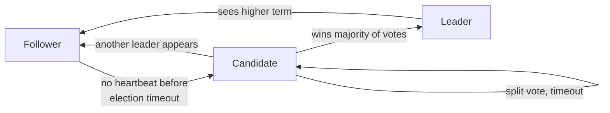
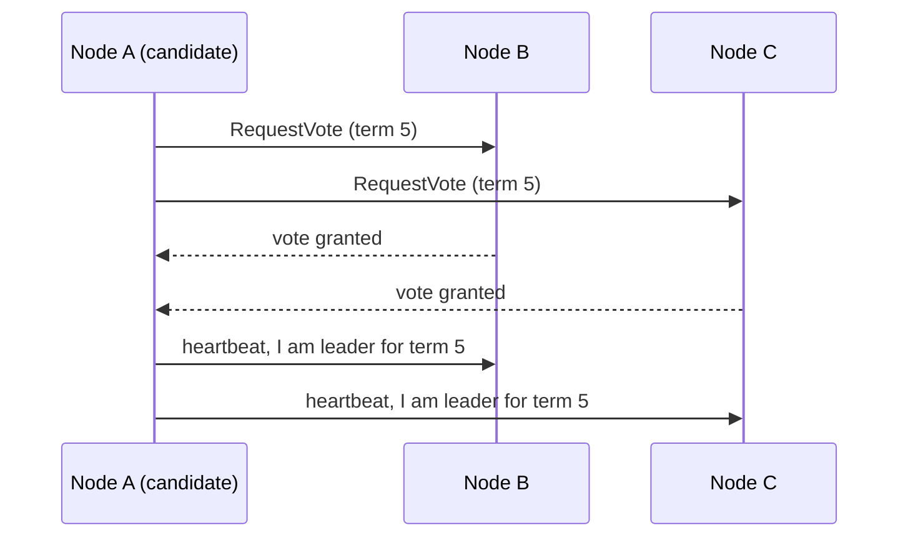

Leader election is the process of **choosing a single node to act as the coordinator** among many. The leader orders writes, assigns work or manages metadata. If it fails, the others elect a new one automatically.

## Why have a leader at all

Many problems become simple with exactly one decision-maker: ordering writes to a log, assigning shards to workers, holding a lock, running a scheduled job exactly once. The hard part is making sure **all nodes agree on who that leader is**, even when nodes crash and networks split.

That's a **consensus** problem, and Paxos and Raft are the classic solutions.

## Raft, step by step

Raft was designed to be easy to understand. Each node is a **follower**, a **candidate** or the **leader**.

1. The leader sends regular [heartbeats](/system-design/heartbeat/) to all followers.
2. If a follower hears nothing before its (randomized) election timeout, it becomes a candidate, increments the **term** number, votes for itself and asks the others for votes.
3. Each node votes for at most one candidate per term. A candidate with a **majority** becomes leader.
4. Randomized timeouts make it unlikely that two candidates split the vote repeatedly.

After election, the leader replicates a **log** of commands to followers. An entry is committed once a majority has stored it. This is how Raft keeps replicated state machines identical.

## Why majorities prevent split brain

With 5 nodes, a leader needs 3 votes. If the network splits into 3 and 2, only the side with 3 can elect a leader. The side with 2 can't reach a majority, so it can't make progress. Two leaders can never both hold a majority in the same term.

That's also why clusters use **odd sizes**: 3 nodes tolerate 1 failure, and 5 tolerate 2. A 4-node cluster still only tolerates 1.

## Paxos

Paxos (Leslie Lamport) came first and proves the same guarantee: nodes agree on a value even with failures, as long as a majority is reachable. It's famously hard to understand and implement, and practical systems use variants like Multi-Paxos. Raft gives equivalent guarantees with a clearer structure, which is why most newer systems choose it.

## Where it's used

- **etcd** (the brain of Kubernetes) and **Consul:** Raft.
- **ZooKeeper:** ZAB, a Paxos-like protocol.
- **Kafka (KRaft mode), CockroachDB, TiKV:** Raft.
- **Google Chubby and Spanner:** Paxos.

In practice you rarely implement this yourself. You use one of these systems to get leader election, locks or config.

## In interviews

You don't need the math, but know that consensus algorithms power metadata stores, distributed logs and locks: "We use etcd for leader election, so only one scheduler instance runs jobs. If it dies, a new leader is elected within seconds."
