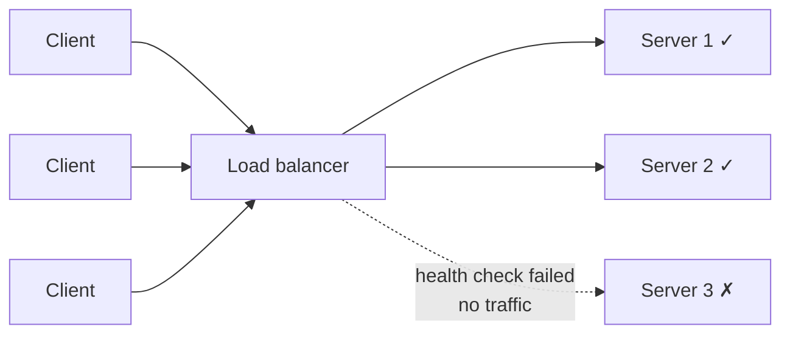
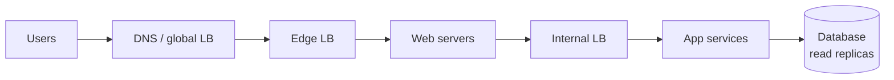

A load balancer spreads incoming traffic across multiple servers so no single server gets overloaded. Clients talk to one address, and the load balancer decides which backend handles each request.

## What it gives you

- **Performance:** work is shared, so each server stays inside its comfortable capacity.
- **Reliability:** one server failing does not bring down the whole system. The load balancer just stops sending it traffic.
- **Elasticity:** add or remove servers behind it without clients noticing, which is what makes autoscaling work.
- **Zero-downtime deploys:** drain one server, update it, put it back, repeat.

## Health checks

Load balancers regularly probe each backend, for example with `GET /health` every few seconds. A server that fails several checks in a row is marked unhealthy and taken out of rotation. When it passes again, it comes back. This is a simple form of [heartbeat](/system-design/heartbeat/) monitoring.

Keep the health endpoint honest. It should fail when the server truly can't serve, for example when it can't reach its database. It should not fail on a minor issue, or one blip will drain the whole fleet.

## Layer 4 vs layer 7

| | Layer 4 (transport) | Layer 7 (application) |
| --- | --- | --- |
| Sees | IP addresses and ports | Full HTTP: path, headers, cookies |
| Routing | Per connection | Per request, by URL or header |
| Speed | Very fast, low overhead | Slightly more work per request |
| Extras | Minimal | TLS termination, path routing, compression |
| Examples | AWS NLB, LVS | AWS ALB, NGINX, HAProxy, Envoy |

## Where load balancers appear

They show up at several tiers, not just the edge:

## Avoiding a new single point of failure

A single load balancer is itself a single point of failure. Production setups run load balancers in pairs (active-passive or active-active) with a floating IP, or use a managed cloud load balancer that's redundant by design.

## In interviews

The load balancer is your first building block when scaling horizontally. Put it in front of any stateless tier, mention health checks, and name the [algorithm](/system-design/load-balancing-algorithms/) you'd use. That covers what most interviewers look for.
