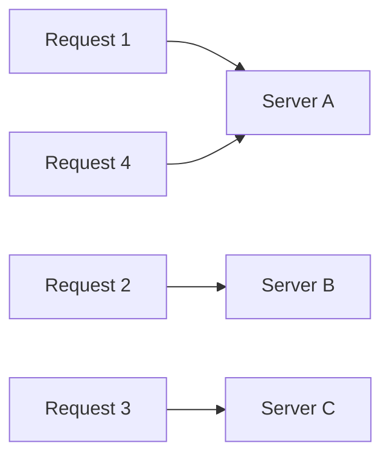

A [load balancer](/system-design/load-balancer/) needs a rule for choosing which server gets the next request. That rule affects fairness, resource usage and user experience.

## Round robin

Cycle through the servers in order: 1, 2, 3, 1, 2, 3...

Simple and fair when requests are similar and servers are identical. It breaks down when some requests take far longer than others, because a server can get stuck with several heavy ones in a row.

**Weighted round robin** gives bigger servers a larger share, for example A:3, B:1.

## Least connections

Send the request to the server with the fewest active connections right now.

This adapts when request duration varies a lot, such as file uploads, report generation or long-lived WebSocket connections. A busy server naturally receives less new work. **Weighted least connections** combines this with server capacity.

## IP hash

Hash the client's IP address to choose a server:

$$\text{server} = \text{hash}(\text{client IP}) \bmod N$$

The same client usually lands on the same server, which gives you simple session stickiness without cookies. The downside: when $N$ changes, most clients get remapped. [Consistent hashing](/system-design/consistent-hashing/) fixes that. Also, many users behind one corporate NAT share an IP and all pile onto one server.

## Others worth knowing

- **Least response time:** pick the server with the lowest recent latency, blended with active connections.
- **Random, or "power of two choices":** pick two servers at random and send to the less loaded one. Very cheap and surprisingly close to optimal at scale.
- **Resource-based:** servers report CPU and memory, and the balancer favours the least loaded.

## Choosing

| Algorithm | Best when | Watch out for |
| --- | --- | --- |
| Round robin | Uniform, short requests | Uneven request costs |
| Weighted round robin | Mixed server sizes | Static weights go stale |
| Least connections | Variable or long requests | Needs connection tracking |
| IP hash | Simple stickiness needed | Remapping on scale, NAT hot spots |
| Power of two choices | Large fleets | Slightly less predictable |

## In interviews

Default to round robin for stateless, uniform APIs and say why. Switch to least connections when requests vary, such as uploads or streaming. If you need stickiness, say you'd rather make the service [stateless](/system-design/stateful-vs-stateless-architecture/) than rely on IP hash.
