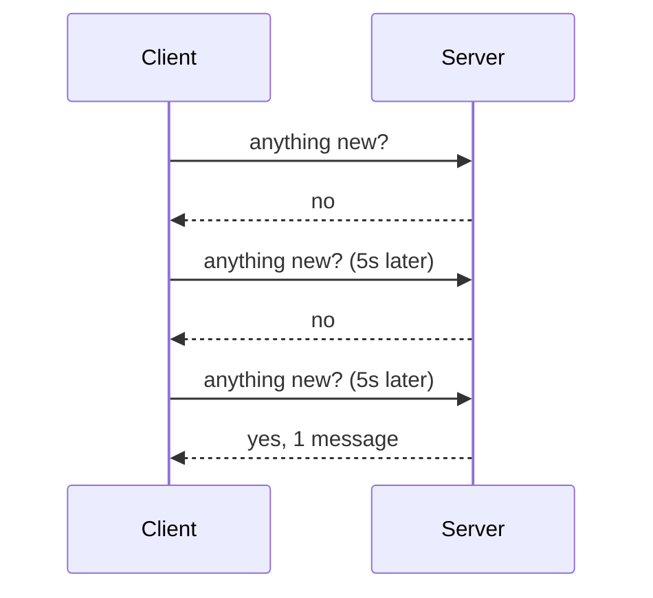
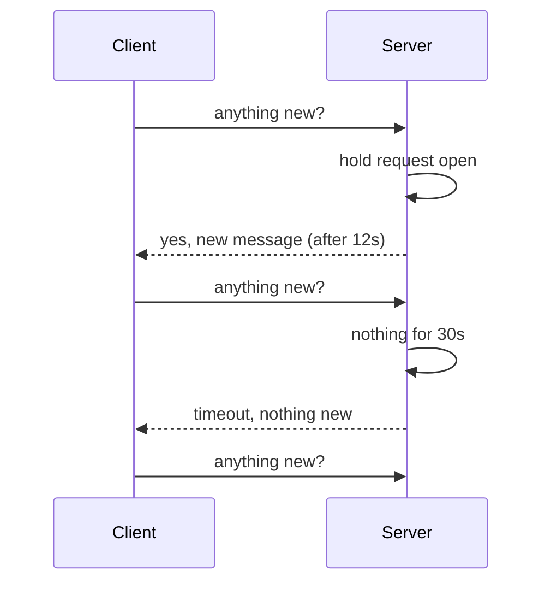

Before WebSockets and SSE were common, the only way to get updates from a server was to ask for them. Polling is still useful today, because it works everywhere plain HTTP works.

## Short polling

The client asks on a fixed interval, for example every 5 seconds, whether there's anything new.

Simple, but wasteful. Most responses are empty, and an update waits on average half the interval before the client sees it. Shorter intervals mean fresher data and much more load.

## Long polling

The client asks, and the server **holds the request open** until there is new data or a timeout (say 30 seconds). As soon as a response comes back, the client immediately opens another request.

Think of it as asking "anything new?" and then waiting quietly until there's an answer. Updates arrive almost instantly, and there are far fewer empty responses.

## Comparison

| | Short polling | Long polling | WebSocket / SSE |
| --- | --- | --- | --- |
| Latency of updates | Up to the interval | Near real time | Real time |
| Empty responses | Many | Few | None |
| Server cost | Many short requests | Many held connections | Persistent connections |
| Infrastructure | Plain HTTP | Plain HTTP | Upgrade or streaming support |
| Works through proxies and firewalls | Yes | Mostly yes | Usually, sometimes blocked |

## Things to get right with long polling

- **Timeouts:** keep the hold time below what proxies and load balancers allow (often 30 to 60 seconds).
- **Missed messages:** an event can happen between one response and the next request. Have the client send a cursor or "last seen ID," and the server returns everything after it.
- **Connection capacity:** each waiting client holds a connection, so use an async server that can hold thousands cheaply.

## When polling is the right call

- Updates are infrequent, and a few seconds of delay is fine (job status, build progress).
- You need maximum compatibility through corporate proxies.
- As a fallback when [WebSockets or SSE](/system-design/websocket-and-server-sent-events-sse/) can't connect. Many real-time libraries do exactly this.

## In interviews

Mention polling as the simple baseline, then upgrade: "Short polling would waste requests at our scale, so I'd use SSE for notifications, with long polling as a fallback."
