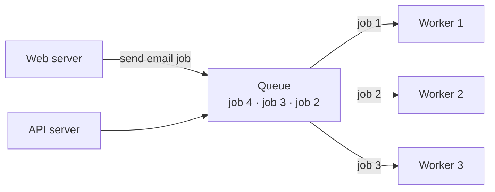
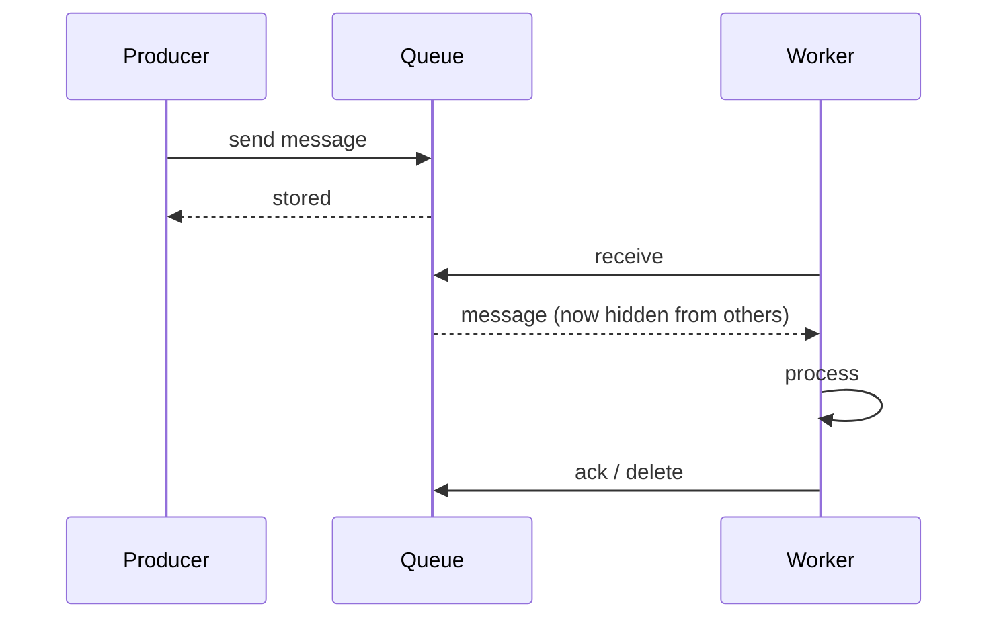

A message queue lets one component send messages to another **without both being online at the same time**. The producer drops a message in the queue and moves on. A consumer picks it up whenever it's ready.

Think of it as a to-do list shared between services.

## Point-to-point delivery

In the point-to-point model, **each message is consumed by exactly one receiver** and then removed from the queue. Several consumers can read the same queue, but they *share* the work, so each message goes to only one of them.

For "every interested service gets a copy," you want [pub/sub](/system-design/pub-sub-publish-subscribe/) instead.

## Why use a queue

- **Decoupling:** the producer doesn't need to know who processes the work or whether they're up right now.
- **Async processing:** the user gets a fast response while slow work (emails, video encoding, PDF generation) happens in the background.
- **Load levelling:** a traffic spike fills the queue instead of overwhelming workers. Workers process at their own steady pace.
- **Independent scaling:** add workers when the queue grows, and remove them when it drains.
- **Resilience:** if workers crash, messages wait in the queue instead of being lost.

## The message lifecycle

If the worker crashes before it acknowledges, the message becomes visible again after a **visibility timeout**, and another worker retries it.

## Delivery guarantees

| Guarantee | Meaning | Trade-off |
| --- | --- | --- |
| At most once | Never redelivered, may be lost | Fast, lossy |
| At least once | Never lost, may be duplicated | Most common default |
| Exactly once | Neither lost nor duplicated | Expensive, limited scope |

Most queues give **at least once**, so consumers must be **[idempotent](/system-design/idempotency/)**. Processing the same message twice must be safe.

## Other things to get right

- **Ordering:** many queues don't guarantee order. Use FIFO queues or partition keys when order matters, such as all events for one order.
- **Poison messages:** a message that always fails would be retried forever. After N attempts, move it to a [dead letter queue](/system-design/dead-letter-queues/).
- **Backpressure:** monitor queue depth and message age. A queue that keeps growing means consumers can't keep up.

## Examples

RabbitMQ, Amazon SQS, ActiveMQ, Azure Service Bus, and Redis-based queues (Sidekiq, BullMQ). Kafka is often used similarly, though it's a log-based streaming platform.

## In interviews

"Uploads put a job on a queue and return immediately. A pool of workers encodes videos, scaling with queue depth. Jobs are idempotent, and failures go to a DLQ after 5 attempts."
