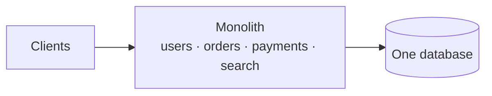
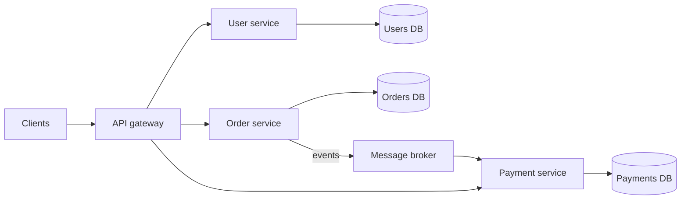

## Monolith

A monolith is a single application that contains many features in one deployable unit: one codebase, one build, one process (or a few identical copies), usually one database.

## Microservices

Microservices split features into separate services that each own their data and talk over the network.

## What microservices buy you

- **Team independence:** each team owns, deploys and releases its service on its own schedule.
- **Independent scaling:** scale search to 50 instances while billing runs on 3.
- **Fault isolation:** a crash in recommendations need not take down checkout, if you add [circuit breakers](/system-design/circuit-breaker-pattern/) and [bulkheads](/system-design/bulkhead-pattern/).
- **Technology freedom:** each service can use the language or [database](/system-design/polyglot-persistence/) that suits it.

## What they cost

- **Network everywhere:** function calls become remote calls that can time out, fail or arrive twice. You now need [retries](/system-design/retry-patterns-and-exponential-backoff/) and [idempotency](/system-design/idempotency/).
- **Distributed data:** no cross-service joins and no single ACID transaction. You need patterns like [SAGA](/system-design/distributed-transactions-saga-pattern/).
- **Debugging:** one user request crosses many services, so you need [distributed tracing](/system-design/distributed-tracing/), centralized logs and metrics.
- **Operations:** service discovery, CI/CD per service, an [API gateway](/system-design/api-gateway/) and versioned contracts.

## Comparison

| | Monolith | Microservices |
| --- | --- | --- |
| Starting speed | Fast | Slow, needs infrastructure first |
| Deployment | All or nothing | Per service |
| Scaling | Whole app together | Per service |
| Data consistency | Local ACID transactions | Eventual, via events or sagas |
| Debugging | Stack trace in one process | Traces across services |
| Best for | Small teams, new products | Many teams, mature domains |

## The usual path

Many great systems started as monoliths and split when the pain became real, for example when deploys queued behind other teams or one hot module needed different scaling. A good middle step is the **modular monolith**: one deployable, but with strict internal module boundaries that can later become service boundaries.

## In interviews

Don't default to microservices. Justify the split: "Ten teams, independent release cycles, and the search workload scales very differently from billing. That's why I'd split these three services. The rest stays together until there's a reason."
