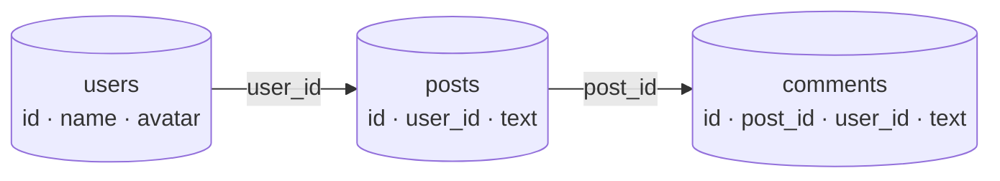
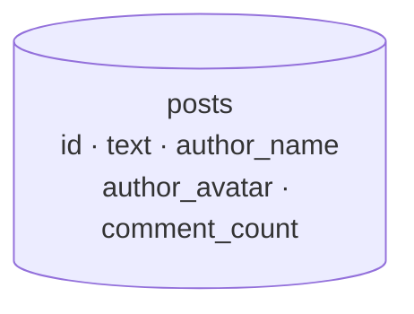

## Normalization: one fact, one place

Normalization organises data into tables so that every fact is stored exactly once. You follow the normal forms (1NF, 2NF, 3NF, and so on) to remove duplication and unwanted dependencies. See [the normalization process](/system-design/normalization-process-in-dbms/).

**Why:** it avoids anomalies. If a user's name is stored in 10,000 posts, renaming them means 10,000 updates, and missing one leaves the data inconsistent. Normalized, it's one update in `users`.

**Cost:** reads need joins. Showing a feed means joining posts, users and comment counts on every request.

## Denormalization: duplicate on purpose

Denormalization intentionally copies data to make reads faster and avoid joins.

Now rendering a post is one read: no joins, no extra lookups. That's why high-scale, read-heavy systems denormalize hot paths, for example storing the author name with each post instead of joining every time.

**Cost:** every write must update all the copies. If you forget, users see a stale name next to some posts.

## Comparison

| | Normalized | Denormalized |
| --- | --- | --- |
| Redundancy | Minimal | Deliberate |
| Reads | Joins, slower at scale | Single lookup, fast |
| Writes | Simple, one place | Must update every copy |
| Consistency risk | Low | Copies can drift |
| Storage | Smaller | Larger |
| Fits | Transactional (OLTP) cores | Read-heavy feeds, analytics, NoSQL |

## Keeping copies in sync

- **Same transaction:** update the original and the copy together, if they're in the same database.
- **Events:** publish `UserRenamed`, and consumers update their copies asynchronously ([eventually consistent](/system-design/strong-vs-eventual-consistency/)). See [pub/sub](/system-design/pub-sub-publish-subscribe/).
- **Materialized views and caches:** let the database or a cache layer maintain the read-optimised copy.

## Where it's safe to denormalize

- Data that **rarely changes:** names, avatars, product titles.
- Data where **brief staleness is fine:** like counts, follower counts.
- **Read paths that dominate traffic:** if a page is read 1,000 times per write, optimise the read.

Keep the **source of truth normalized**, and denormalize read models derived from it. See also [denormalization in databases](/system-design/denormalization-in-databases/).

## In interviews

"The orders database is normalized because correctness matters. The feed is a denormalized read model: author name and counts are copied onto each post and updated through events." The real skill is knowing where you can safely denormalize without breaking consistency.
