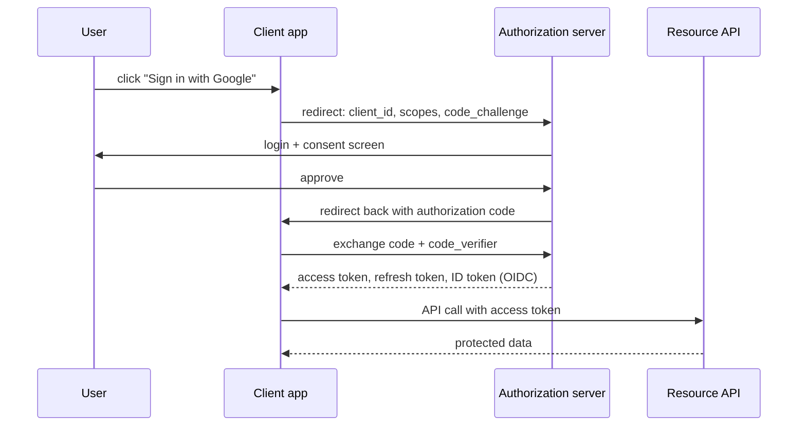

These two standards power almost every "Sign in with Google" button and every app that connects to another app's API.

- **OAuth 2.0** is a framework for **delegated authorization**. It lets a user give an app limited access to their resources **without sharing their password**.
- **OpenID Connect (OIDC)** is a thin layer on top of OAuth 2.0 that adds **authentication**: proof of *who the user is*, plus basic profile information.

In short, OAuth answers "what may this app do?" and OIDC answers "who is this user?"

## The roles

| Role | Who it is | Example |
| --- | --- | --- |
| Resource owner | The user | You |
| Client | The app that wants access | A photo printing app |
| Authorization server | Issues tokens after login and consent | Google accounts |
| Resource server | The API holding the data | Google Photos API |

## Authorization code flow (with PKCE)

This is the recommended flow for web, mobile and single-page apps.

1. The app redirects the user to the authorization server with the **scopes** it wants (for example `photos.read`).
2. The user logs in **on the authorization server**, so the app never sees the password, and approves.
3. The app receives a short-lived **authorization code** and exchanges it, server to server, for tokens.
4. **PKCE** (a one-time secret: the challenge is sent first, the verifier later) proves the same app that started the flow is the one redeeming the code. That stops intercepted codes from being used.

## The tokens

- **Access token:** sent to APIs as `Authorization: Bearer ...`. Short-lived (minutes to an hour), limited to the granted scopes. Often a signed JWT that APIs verify without calling the authorization server.
- **Refresh token:** used to get new access tokens without asking the user to log in again. Long-lived and sensitive, so store it securely.
- **ID token (OIDC only):** a signed JWT describing the user (`sub`, `email`, `name`, issuer, audience, expiry). It's for the **client** to learn who logged in, not for calling APIs.

OIDC also defines the `openid` scope, a `/userinfo` endpoint and discovery documents (`/.well-known/openid-configuration`), so clients can configure themselves automatically.

## Other flows

- **Client credentials:** machine to machine, with no user involved, such as a backend job calling an internal API.
- **Device code:** for TVs and CLIs without a browser: "go to this URL and enter this code."
- **Implicit and password flows:** legacy, and no longer recommended.

## Security essentials

- Always use HTTPS, validate redirect URIs exactly, and use PKCE everywhere.
- Validate tokens properly: signature, issuer, audience and expiry.
- Request the **minimum scopes** the app needs.
- Keep access tokens short-lived, and rotate and revoke refresh tokens.

## In interviews

The key idea is that an authorization server issues tokens that clients and APIs can trust: "Users sign in through OIDC. The gateway validates the JWT access token on every request, and services trust the claims it forwards, so no service ever handles passwords." See also [authentication and authorization](/system-design/authentication-and-authorization/).
