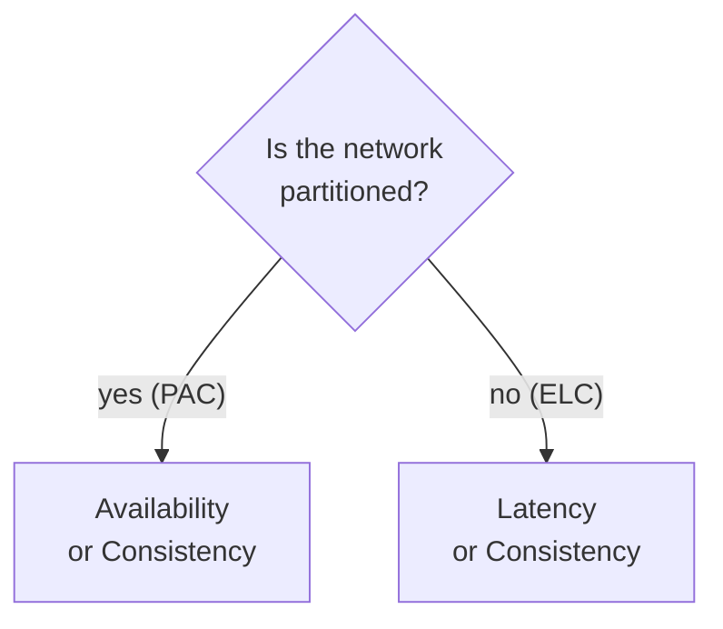

[CAP](/system-design/cap-theorem/) only describes what happens during a network partition. But partitions are rare, and your system spends most of its life with a healthy network. PACELC extends CAP to cover that normal case:

> If there is a **P**artition, choose **A**vailability or **C**onsistency. **E**lse, choose **L**atency or **C**onsistency.

## Why the "else" half matters

To make a write strongly consistent, the system has to confirm it on several replicas before acknowledging it. If those replicas sit in different regions, that confirmation costs a round trip, often tens to hundreds of milliseconds.

The alternative is to acknowledge after writing locally and replicate in the background. That is fast, but a read on another replica may briefly see old data.

So even on a perfect day, you are still choosing:

- **Low latency:** fast reads and writes, eventually consistent.
- **Consistency:** always-correct reads, slower because of coordination.

## Classifying real systems

PACELC gives every database a four-letter label:

| System | During partition | Else | Label |
| --- | --- | --- | --- |
| Cassandra, DynamoDB (default) | Availability | Latency | PA/EL |
| MongoDB (default config) | Availability | Consistency | PA/EC |
| Spanner, CockroachDB, traditional RDBMS clusters | Consistency | Consistency | PC/EC |

Spanner is the classic PC/EC system. It keeps strong consistency across regions and accepts the latency cost, using synchronized clocks to keep that cost bounded.

## What it explains

PACELC explains why some databases feel fast but occasionally stale, while others are always accurate but slower. Neither is wrong. They picked different points on the latency versus consistency curve.

## In interviews

When you pick a database, state both halves. "For the user profile store I'd take PA/EL: low latency matters more than seeing an edit a few hundred milliseconds late. For the ledger I'd take PC/EC and accept the extra write latency." It shows you understand that consistency has a cost even when nothing is broken.
