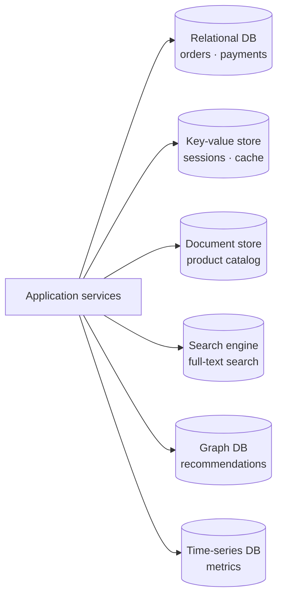
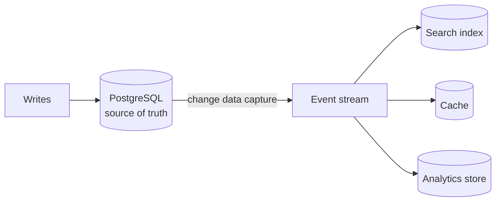

Polyglot persistence means **using multiple types of databases in the same system, each chosen for what it does best**, instead of forcing every workload into one database.

## A typical layout

| Need | Store type | Examples |
| --- | --- | --- |
| Transactions, strong consistency | Relational | PostgreSQL, MySQL |
| Fast lookups by key, caching | Key-value | Redis, DynamoDB |
| Flexible, nested records | Document | MongoDB, Couchbase |
| Full-text search, facets | Search engine | Elasticsearch, OpenSearch |
| Relationships and traversals | Graph | Neo4j, Neptune |
| Metrics over time | Time-series | InfluxDB, TimescaleDB, Prometheus |
| Similarity search on embeddings | Vector | See [vector databases](/system-design/vector-databases/) |
| Files and blobs | Object storage | S3, GCS, R2 |

## Why bother

- **Performance:** each store is optimised for its access pattern. A search engine does relevance ranking that SQL `LIKE` can't.
- **Scalability:** scale each store independently based on its load.
- **Fit:** a graph query like "friends of friends who like X" is a few lines in a graph database and a painful self-join in SQL.

## Keeping data in sync

Usually one store is the **source of truth**, and the others are derived from it:

Changes flow out through events or change data capture (reading the database's [WAL](/system-design/write-ahead-logging-wal/)). Derived stores are [eventually consistent](/system-design/strong-vs-eventual-consistency/), and you can rebuild them from the source if they drift.

## The costs

- **Operational complexity:** each database needs backups, monitoring, upgrades, security and expertise.
- **Consistency across stores:** no transaction spans PostgreSQL and Elasticsearch, so sync bugs are real.
- **Team knowledge:** every new store is something the on-call engineer must understand at 3 a.m.

## Practical advice

Start with one solid general-purpose database. PostgreSQL alone covers relational, JSON documents, full-text search and even vectors. Add a specialised store only when a concrete need justifies it, such as search relevance, extreme write volume or graph traversals.

## In interviews

Show that every store earns its place: "Postgres for orders, because we need transactions. Redis for sessions and hot reads. Elasticsearch for product search, fed by CDC from Postgres." Each choice comes with a reason.
