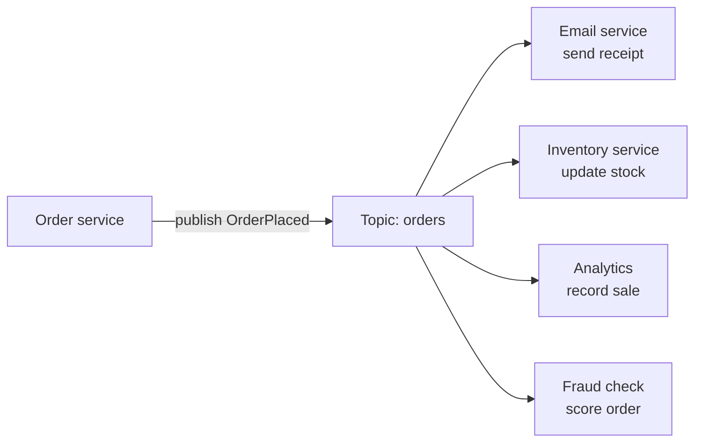

In publish/subscribe, **publishers send messages to a topic**, not to specific consumers. **Subscribers** listen to the topics they care about, and **each one receives its own copy** of every relevant message.

## Fan-out to many services

The order service doesn't know or care who's listening. It announces "an order was placed." Each subscriber reacts in its own way. Adding a new feature, say loyalty points, means adding a new subscriber, with **zero changes** to the publisher.

## Pub/sub vs point-to-point queue

| | [Message queue](/system-design/message-queues/) | Pub/sub |
| --- | --- | --- |
| Each message goes to | One consumer | Every subscriber |
| Purpose | Distribute work | Broadcast events |
| Typical message | Command: "send this email" | Event: "order was placed" |
| Adding consumers | Shares the load | Adds a new reaction |

Many systems combine them: each subscriber gets its own queue fed by the topic, and several workers share that queue. AWS SNS fanning out to SQS queues, and Kafka consumer groups, both work this way.

## Why it's useful

- **Loose coupling:** producers and consumers evolve independently.
- **Extensibility:** new consumers plug in without touching existing code.
- **Parallel reactions:** many services act on the same event at once.
- **Replay** (with log-based systems like Kafka): new consumers can read historical events from the start.

## Things to watch

- **Delivery is usually at least once:** subscribers must be [idempotent](/system-design/idempotency/).
- **Ordering:** often guaranteed only within a partition or key, such as all events for one order ID.
- **Slow subscribers:** each subscriber needs its own buffer, so one slow consumer doesn't hold back the others.
- **Schema changes:** many teams depend on the event format, so version it and evolve it compatibly.
- **Invisible flows:** it can be hard to see who reacts to what. Document topics and use [tracing](/system-design/distributed-tracing/).

## Where it shows up

- **[Event-driven architectures](/system-design/event-driven-architecture/)** and [event sourcing](/system-design/event-sourcing-pattern/).
- **Activity feeds and notifications.**
- **Real-time fan-out** across [WebSocket](/system-design/websocket-and-server-sent-events-sse/) servers, for example with Redis pub/sub.
- **Cache invalidation** across many app servers.

Examples: Apache Kafka, Google Cloud Pub/Sub, AWS SNS and EventBridge, Redis pub/sub, NATS, and RabbitMQ fanout exchanges.

## In interviews

Pub/sub often comes up in event-driven designs: "The order service publishes `OrderPlaced`. Email, inventory and analytics each subscribe with their own consumer group, so we can add new reactions without touching checkout."
