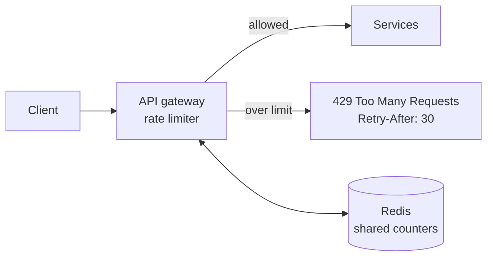
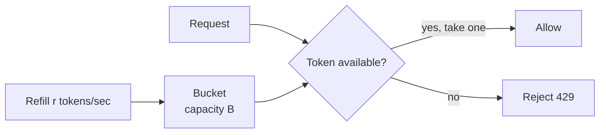

Rate limiting controls **how many requests a client can make in a given time window**, for example 100 requests per minute per API key. Think of it as a safety brake that keeps shared resources from being overwhelmed.

## Why you need it

- **Abuse protection:** scrapers, credential stuffing, brute-force logins, DDoS attempts.
- **Accidental overload:** a client bug in a retry loop can send thousands of requests a second.
- **Fairness:** one heavy customer shouldn't slow everyone else down.
- **Cost control:** expensive endpoints (AI calls, SMS, exports) get strict quotas.

## Where it lives

Limits are usually enforced at the [API gateway](/system-design/api-gateway/) or [load balancer](/system-design/load-balancer/), before requests reach the services. Rejected requests get **HTTP 429** with a `Retry-After` header, so well-behaved clients know when to come back.

## Algorithms

### Fixed window

Count requests per key in fixed slots such as "12:00:00 to 12:00:59." Reset each window.

Simple and cheap: one counter per key. The flaw is a **boundary burst**: 100 requests at 12:00:59 and 100 more at 12:01:00 means 200 in two seconds.

### Sliding window

Smooth that out by looking at the last 60 seconds from *now*:

- **Sliding log:** store a timestamp per request and count those in the window. Exact, but memory-heavy.
- **Sliding window counter:** weight the previous window's count by how much of it still overlaps. Close to exact, and cheap.

### Token bucket

Each key has a bucket that holds up to $B$ tokens and refills at $r$ tokens per second. Each request takes one token. No token means the request is rejected.

It allows **short bursts** (up to $B$) while enforcing an average rate ($r$). That matches real traffic well, which is why AWS, Stripe and most gateways use it. **Leaky bucket** is a cousin that drains requests at a constant rate, smoothing output instead of allowing bursts.

| Algorithm | Bursts | Accuracy | Memory |
| --- | --- | --- | --- |
| Fixed window | 2× at boundaries | Low | Tiny |
| Sliding log | None | Exact | High |
| Sliding window counter | Small | High | Small |
| Token bucket | Controlled, up to B | High | Small |

## Distributed rate limiting

With many gateway instances, each one's local counters only see part of the traffic. Common fixes:

- **Central store:** keep counters in Redis and update them atomically (`INCR` with expiry, or a Lua script for the token bucket).
- **Local + sync:** count locally and sync periodically. Slightly less accurate, much faster.

Decide what happens if Redis is down: **fail open** (allow traffic, risk overload) or **fail closed** (block traffic, risk an outage). Most public APIs fail open.

## In interviews

Name the key, the limit, the algorithm and the place: "Token bucket per API key, 100 per minute with bursts up to 20, enforced at the gateway with counters in Redis, returning 429 with Retry-After." See also [rate limiting algorithms](/system-design/rate-limiting-algorithm/).
