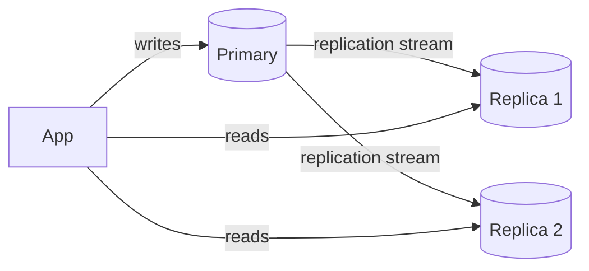
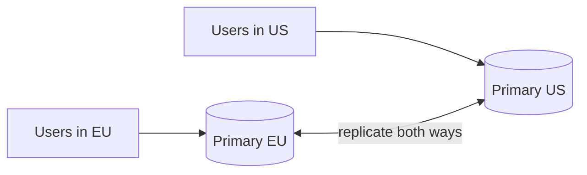

Replication means keeping multiple copies of the same data on different nodes. It improves read performance and availability, but every extra copy makes consistency harder.

## Primary–replica (master–slave)

One node, the **primary**, accepts all writes. It streams changes to one or more **replicas**, which serve reads.

- **Good:** simple, no write conflicts, and reads scale by adding replicas.
- **Bad:** writes still bottleneck on one node, and replicas may lag behind.

This is the default setup for PostgreSQL, MySQL and most managed databases.

## Multi-primary (master–master)

Several nodes accept writes and replicate to each other.

- **Good:** writes are local to each region (low latency), and losing one primary doesn't stop writes.
- **Bad:** **write conflicts**. Two users edit the same row on different primaries at the same time. You need a resolution rule: last-write-wins by timestamp, merge logic, or CRDTs. Each has trade-offs, and last-write-wins can silently drop data.

## Synchronous vs asynchronous

| | Synchronous | Asynchronous |
| --- | --- | --- |
| Write acknowledged when | Replica confirms | Primary has it |
| Write latency | Higher | Lower |
| Data loss on primary crash | None | Recent writes may be lost |
| Replica freshness | Up to date | May lag |

A common compromise is **semi-synchronous**: wait for one replica, replicate to the rest asynchronously.

## Replication lag

With async replication, a replica may be seconds behind. The classic bug: a user updates their profile, the page reloads from a replica, and the old value appears. Fixes:

- **Read-your-writes:** route a user's reads to the primary for a short time after they write.
- **Monotonic reads:** pin a user to one replica so they never see time go backwards.
- Monitor lag and remove replicas that fall too far behind.

See [strong vs eventual consistency](/system-design/strong-vs-eventual-consistency/).

## Failover

When the primary dies, a replica must be **promoted**:

1. Detect the failure, usually with [heartbeats](/system-design/heartbeat/) and timeouts.
2. Choose the most up-to-date replica, often through [leader election](/system-design/leader-election-paxos-raft/).
3. Repoint writes to the new primary.

Risks: lost async writes that never reached the new primary, and **split brain**, where the old primary comes back and both accept writes. Fencing (forcibly cutting off the old primary) prevents that.

## In interviews

Expect two follow-ups: how replication lag affects reads, and how failover works when the primary dies. Have one sentence ready for each.
