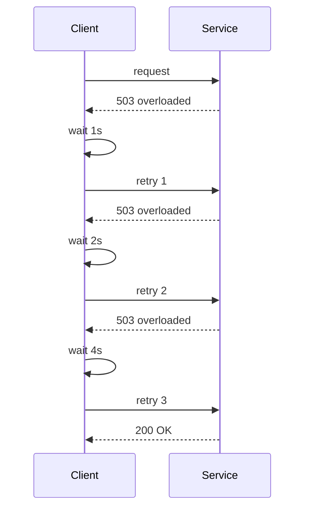
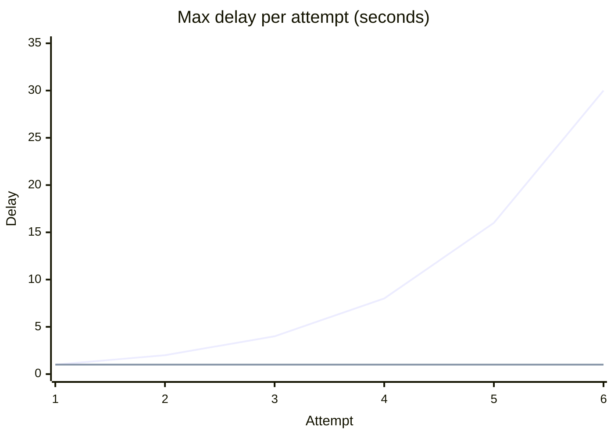

In distributed systems, many failures are **transient**: a network blip, a timeout, a server restarting, a brief overload. Trying again a moment later often just works. Retries are how you recover from those errors automatically.

But retries done badly make outages worse.

## Exponential backoff

Instead of retrying immediately, wait longer after each failure: 1 s, 2 s, 4 s, 8 s, and so on.

$$\text{delay} = \min(\text{cap},\ \text{base} \times 2^{\text{attempt}})$$

Backoff gives a struggling service time to recover instead of being hammered by clients that retry instantly.

## Jitter: avoid the thundering herd

If 10,000 clients fail at the same moment and all retry at exactly 1 s, 2 s and 4 s, they hit the service in synchronized waves. That's a **thundering herd**. Add **jitter** (randomness) to spread them out:

$$\text{delay} = \text{random}(0,\ \min(\text{cap},\ \text{base} \times 2^{\text{attempt}}))$$

This "full jitter" approach is simple and spreads load very effectively.

The solid line is exponential backoff capped at 30 s. The dashed line is a fixed 1 s retry, which keeps hammering the service at the same rate.

## Retry rules that matter

- **Only retry transient errors:** timeouts, connection resets, 429, 502, 503, 504. **Never** retry 400, 401, 403 or 404. The same request will fail the same way.
- **Respect `Retry-After`** when the server sends it.
- **Cap the attempts:** 3 to 5 is typical. After that, fail, alert, or send the message to a [dead letter queue](/system-design/dead-letter-queues/).
- **Retry at one layer only.** If the app, the client library and the load balancer each retry 3 times, one request can become 27.
- **Use a retry budget:** for example, retries may add at most 10% extra load. When the budget is spent, stop retrying.
- **Make operations [idempotent](/system-design/idempotency/).** A retry after a timeout might repeat something that actually succeeded, such as a charge.

## Retries and circuit breakers

Retries handle short blips. When a dependency is truly down, a [circuit breaker](/system-design/circuit-breaker-pattern/) stops the retries altogether, so the system doesn't keep piling on work that will fail.

## In interviews

"Clients retry transient errors up to 3 times with exponential backoff and full jitter, only on idempotent operations or with idempotency keys. A circuit breaker stops retries if the service is down." Retries without backoff can make outages worse instead of helping.
