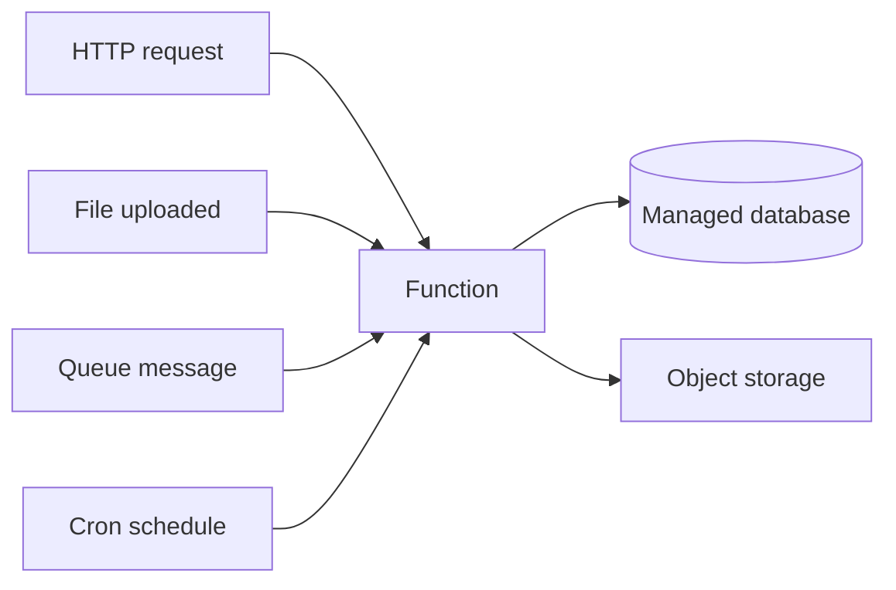

Serverless lets you run small pieces of code in the cloud without provisioning or managing servers. You upload a function, connect it to a trigger, and the platform runs it, scales it and bills you per execution.

There are still servers. You just don't see them, patch them or pay for them while idle.

## How it works

A trigger fires, the platform starts (or reuses) an instance of your function, runs it, and scales to as many parallel instances as traffic needs, including down to zero.

Examples: AWS Lambda, Google Cloud Functions, Azure Functions, Cloudflare Workers.

## Where it fits

- **Event-driven glue:** resize an image when it lands in storage, process a webhook, react to a queue message.
- **Spiky or low traffic:** an API that sits idle for hours and then gets a burst.
- **Scheduled jobs:** nightly reports, cleanups, syncs.
- **Lightweight APIs and backends** for side projects and prototypes.

## The trade-offs

| Benefit | Cost |
| --- | --- |
| No servers to manage | Less control over runtime and environment |
| Scales automatically, to zero | **Cold starts** add latency when a new instance boots |
| Pay per execution | Can cost more than servers at steady high volume |
| Built-in high availability | Execution time and memory limits |
| Fast to ship | Harder local testing and debugging, vendor lock-in |

**Cold starts** matter most. When no warm instance exists, the platform has to load your code and runtime first, which can add from a few milliseconds to over a second depending on the platform and language. Edge runtimes based on isolates start much faster than container-based functions.

## Design tips

- Keep functions **stateless and short**. Persist state in managed stores. See [stateful vs stateless](/system-design/stateful-vs-stateless-architecture/).
- Make handlers **[idempotent](/system-design/idempotency/)**, because triggers often deliver at least once.
- Watch **downstream limits**. A thousand concurrent functions can exhaust a database's connection pool, so use connection pooling or a proxy.
- For long-running work, chain functions through a [queue](/system-design/message-queues/) or use a workflow service.

## In interviews

Think of serverless as functions as a service, ideal for glue code and lightweight services. Good answer: "The thumbnail generator is a serverless function triggered by uploads. It's bursty and stateless. The core API runs on containers because traffic is steady and we want predictable latency."
