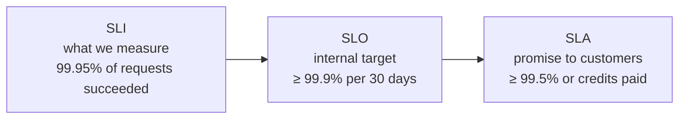

These three terms describe reliability at different levels. The easy way to remember them: **SLA is the contract, SLO is the goal, SLI is the scoreboard.**

## SLI: Service Level Indicator

The **actual measured metric**. A good SLI reflects what users experience:

- **Availability:** successful requests ÷ total requests.
- **Latency:** share of requests faster than 300 ms.
- **Freshness:** share of reads that return data less than 1 minute old.
- **Correctness or durability** for data systems.

Measure as close to the user as possible, for example at the load balancer or from client telemetry, not just "the process is running."

## SLO: Service Level Objective

An **internal target** for an SLI over a time window, which engineers aim to meet. For example: "99.9% of checkout requests succeed over a rolling 30 days" or "p95 latency below 300 ms."

SLOs are usually **stricter than the SLA**, so you notice problems and fix them before you break a promise to customers.

## SLA: Service Level Agreement

An **external promise** to customers, usually in a contract, with consequences if it's missed, typically service credits or refunds. For example: "99.9% monthly uptime, or you get 10% back."

Not every service has an SLA, but every important service should have SLOs.

## What the nines actually mean

| Availability | Downtime per 30 days | Downtime per year |
| --- | --- | --- |
| 99% | 7.2 hours | 3.65 days |
| 99.9% | 43.2 minutes | 8.76 hours |
| 99.95% | 21.6 minutes | 4.38 hours |
| 99.99% | 4.3 minutes | 52.6 minutes |
| 99.999% | 26 seconds | 5.3 minutes |

Each extra nine is roughly **10 times harder and more expensive**. A service also can't be more available than the dependencies it needs: three critical dependencies at 99.9% each give at most about $0.999^3 \approx 99.7\%$.

## Error budgets

If the SLO is 99.9%, you're allowed 0.1% failure. That's the **error budget**: for a million requests a month, about 1,000 can fail.

- **Budget left:** ship features, run experiments, take calculated risks.
- **Budget burned:** freeze risky launches and focus on reliability until it recovers.

This turns "reliability versus speed" from an argument into a data-driven decision. Alert on **burn rate** (how fast the budget is being used), not just on a single failure.

## In interviews

Using these terms correctly shows maturity: "Our SLI is the fraction of successful checkout requests at the load balancer. The SLO is 99.95% over 30 days, the SLA promises 99.9%, and we alert when the error budget burns faster than expected."
