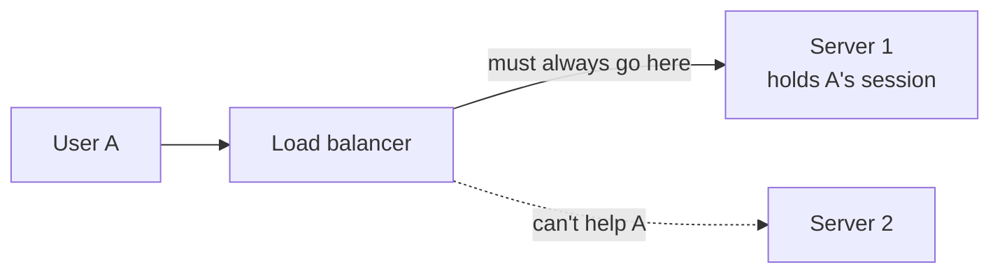
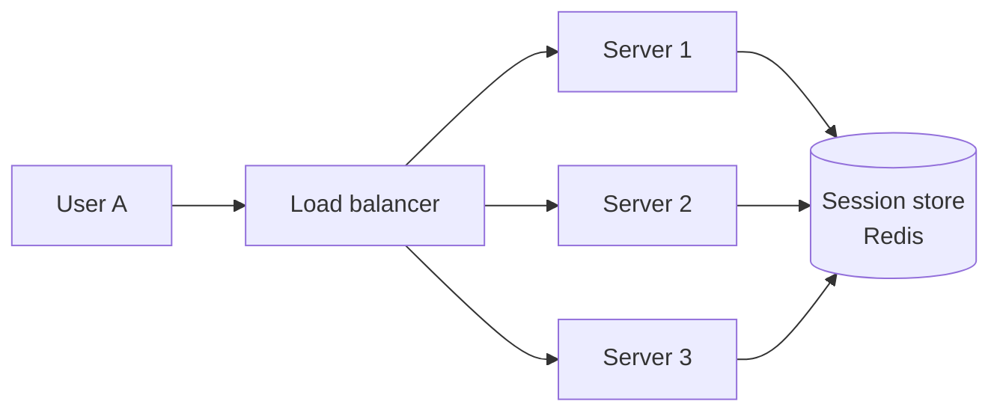

The question is simple: does the server remember anything about a client between requests?

- A **stateful** service keeps user context in its own memory or disk, such as session data, a shopping cart or an open game.
- A **stateless** service treats every request as new. Anything it needs comes from the request itself (a token) or from an external store (cache, database).

## Why stateful is hard to scale

If server 1 holds user A's session, every request from A must reach server 1. That forces sticky sessions, makes load uneven, and means a crash on server 1 logs user A out or loses their cart.

## Why stateless is easy to scale

Any instance can handle any request because the state lives in a shared store. You can add or remove servers freely, the load balancer can use any [algorithm](/system-design/load-balancing-algorithms/), and a crashed instance costs nothing but its in-flight requests.

## Trade-offs

| | Stateful | Stateless |
| --- | --- | --- |
| Horizontal scaling | Hard, needs sticky routing | Easy, any node works |
| Failover | Session lost or must be replicated | Transparent |
| Latency | Fast, state is local | Extra hop to fetch state |
| Code complexity | Often simpler | Needs external store and tokens |

## Ways to keep services stateless

- **Tokens:** put identity in a signed token (for example a JWT) the client sends on every request. See [OAuth 2.0 and OIDC](/system-design/oauth-2-0-and-oidc/).
- **External session store:** Redis or Memcached keyed by session ID.
- **Database for durable state:** carts, drafts and preferences go to the database, not process memory.
- **Object storage for files:** uploads go to S3-style storage, not local disk.

## When stateful is right

Some workloads are inherently stateful: databases, [WebSocket](/system-design/websocket-and-server-sent-events-sse/) connection servers, multiplayer game servers, stream processors. The goal isn't zero state. It's to keep state in a few specialised components and keep everything else stateless.

## In interviews

Say it explicitly: "The API tier is stateless. Sessions live in Redis and auth uses signed tokens, so we can autoscale and lose any instance without users noticing."
