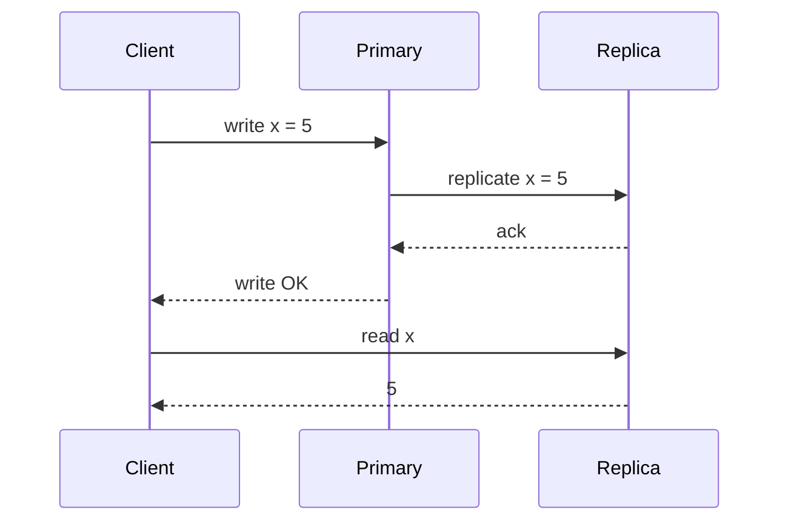
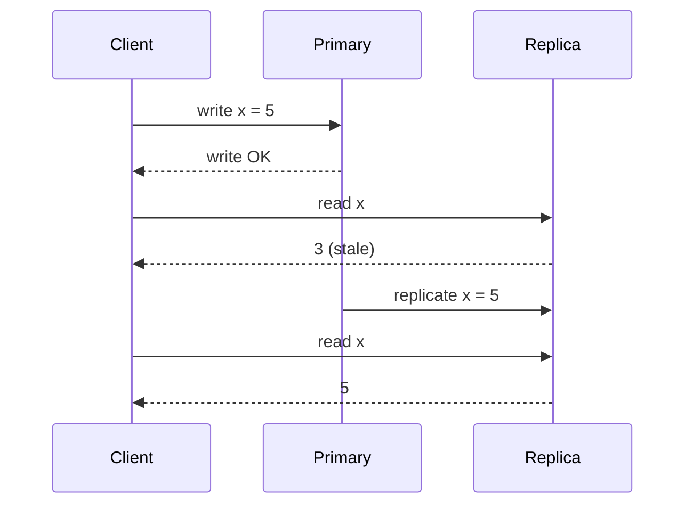

Once data lives on more than one node, you have to decide what readers are allowed to see right after a write.

- **Strong consistency:** after a write completes, every subsequent read, on any node, returns that write.
- **Eventual consistency:** updates spread over time. Nodes may briefly disagree, but if writes stop, they all converge to the same value.

## Strong consistency

The write is acknowledged only after enough replicas have it, so no reader can land on a stale copy.

Easy to reason about, because it behaves like a single machine. The cost is latency (waiting for replicas) and availability (if replicas can't be reached, writes fail). See [CAP](/system-design/cap-theorem/) and [PACELC](/system-design/pacelc-theorem/).

## Eventual consistency

The write is acknowledged as soon as one node has it. Replication happens in the background.

Fast and always available, but the application has to tolerate stale reads and sometimes resolve conflicting writes.

## Middle grounds worth knowing

- **Read-your-writes:** a user always sees their own updates, even if others see them later. Often done by routing that user's reads to the primary for a short window.
- **Monotonic reads:** a user never sees data go "back in time" between two reads.
- **Quorums:** with $N$ replicas, writing to $W$ and reading from $R$ where $W + R > N$ guarantees the read overlaps the latest write.

## Choosing

| Use strong consistency for | Eventual consistency is fine for |
| --- | --- |
| Account balances, payments | Like and view counters |
| Inventory at checkout | Social timelines and feeds |
| Unique usernames, locks | Product reviews, recommendations |
| Leader election, config | DNS, caches, search indexes |

## In interviews

Match the model to the user experience: "If a follower sees a new post two seconds late, no one notices, so the feed is eventually consistent. If two users can buy the last ticket, that's a bug, so ticket inventory is strongly consistent." Mention read-your-writes for the user's own profile edits. It's the detail that shows depth.
