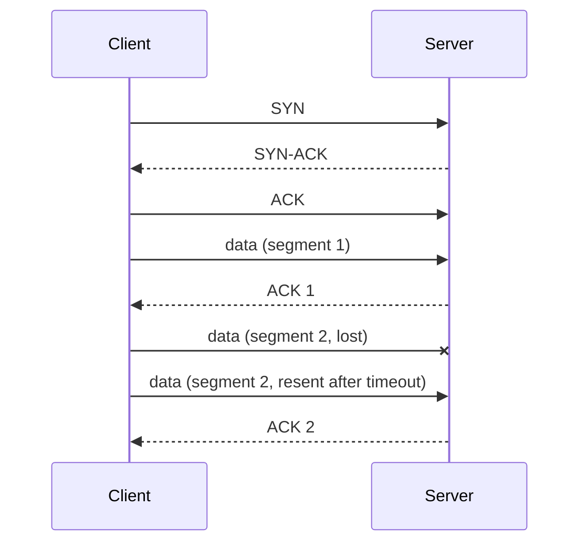

TCP and UDP are the two main transport protocols on the internet. Both move data between machines. They differ in how much they promise.

## TCP: reliable and ordered

TCP is **connection-oriented**. Before any data flows, the two sides set up a connection with a three-way handshake:

TCP then guarantees:

- **Delivery:** lost packets are detected and retransmitted.
- **Order:** data arrives in the order it was sent.
- **Integrity:** checksums catch corruption.
- **Flow and congestion control:** the sender slows down if the receiver or network is overwhelmed.

The cost is overhead: a handshake round trip before sending, and **head-of-line blocking**, where one lost packet holds up everything behind it until it's resent.

## UDP: fast and light

UDP is **connectionless**. It just sends datagrams. No handshake, no acknowledgments, no retransmission, no ordering. Packets may arrive late, out of order, duplicated, or not at all.

That sounds bad, but it's exactly right when **fresh data beats complete data**. In a video call, a packet that arrives 300 ms late is useless anyway. Better to skip it and play the next one.

## Side by side

| | TCP | UDP |
| --- | --- | --- |
| Connection | Handshake first | None |
| Delivery | Guaranteed, retransmits | Best effort |
| Ordering | Preserved | Not preserved |
| Overhead | Higher | Minimal |
| Latency | Higher, especially on lossy links | Lower |
| Used by | HTTP/1.1, HTTP/2, databases, SSH, email | DNS, video calls, games, VoIP, QUIC |

## The analogy

TCP is **registered mail**: tracked, signed for, resent if lost, delivered in order. UDP is **quick postcards**: cheap and fast, but some may never arrive.

## The interesting twist

[HTTP/3](/system-design/http-2-and-http-3-quic/) runs on **QUIC**, which is built on UDP. QUIC re-implements reliability and encryption in user space, per stream, so it gets TCP-like guarantees without TCP's head-of-line blocking or slow handshakes. Many modern protocols now use UDP as a blank canvas.

## In interviews

Pick by requirement: "Payment API over TCP, because correctness matters. Live location updates for drivers over UDP or WebRTC, because the next update replaces the last one anyway."
