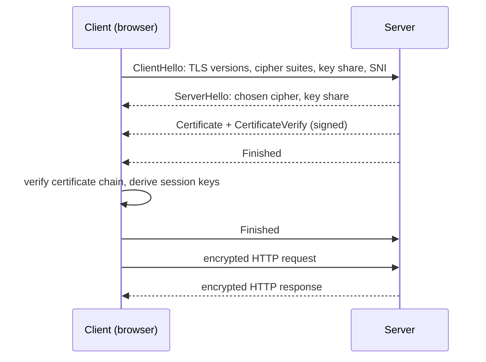

TLS (Transport Layer Security, the successor to SSL) secures communication between a client and a server. It gives you three guarantees:

- **Confidentiality:** traffic is encrypted, so eavesdroppers see noise.
- **Integrity:** any tampering in transit is detected.
- **Authentication:** the client verifies it's really talking to `bank.com`, not an impostor.

This is what puts the padlock in your browser. Without TLS, anyone on the network (public Wi-Fi, a compromised router, an ISP) could read or modify sensitive traffic.

## The TLS 1.3 handshake

Before any application data flows, client and server run a handshake to agree on algorithms, authenticate the server and derive shared keys.

1. **ClientHello:** the client lists the TLS versions and cipher suites it supports, sends its half of a key exchange (an ephemeral Diffie-Hellman key share), and names the site it wants (SNI).
2. **ServerHello:** the server picks the cipher suite and sends its own key share. Both sides can now compute the **same shared secret**, without it ever crossing the network.
3. **Certificate:** the server proves its identity with a certificate signed by a trusted certificate authority (CA), and signs the handshake with its private key to prove it owns that certificate.
4. **Finished:** both sides confirm that the handshake wasn't tampered with. From here on, everything is encrypted with fast **symmetric** keys.

TLS 1.3 completes this in **one round trip** (TLS 1.2 needed two). Resumed sessions can even send data immediately (0-RTT), with some replay-attack caveats.

## Certificate verification

The client checks that:

- the certificate chains up to a **root CA** in its trust store,
- the domain name matches the site it requested,
- the certificate is within its validity dates and hasn't been revoked.

If any check fails, you get the browser's full-page warning.

## Why asymmetric and symmetric crypto are both used

Asymmetric cryptography (key exchange, signatures) solves "how do two strangers agree on a secret and prove identity?", but it's slow. Symmetric encryption (AES-GCM, ChaCha20) is fast. TLS uses the slow kind once, to set up the fast kind for the rest of the session.

**Forward secrecy:** because the key exchange uses ephemeral keys, stealing the server's private key later doesn't decrypt past recorded traffic.

## TLS in system design

- **TLS termination** at the [load balancer or reverse proxy](/system-design/forward-proxy-vs-reverse-proxy/) offloads crypto work from app servers.
- **End-to-end or re-encryption:** encrypt again between the proxy and the backends for sensitive data.
- **mTLS (mutual TLS):** both sides present certificates, so services authenticate each other. It's a core building block of [zero trust](/system-design/zero-trust-security/) and service meshes.
- **Certificate management:** automate issuance and renewal (Let's Encrypt with ACME, cert-manager). Expired certificates cause a surprising number of outages.

## In interviews

"TLS terminates at the edge load balancer. Internal service-to-service traffic uses mTLS through the service mesh, and certificates are rotated automatically." See also [SSL and TLS](/system-design/secure-socket-layer-ssl-and-transport-layer-security-tls/).
