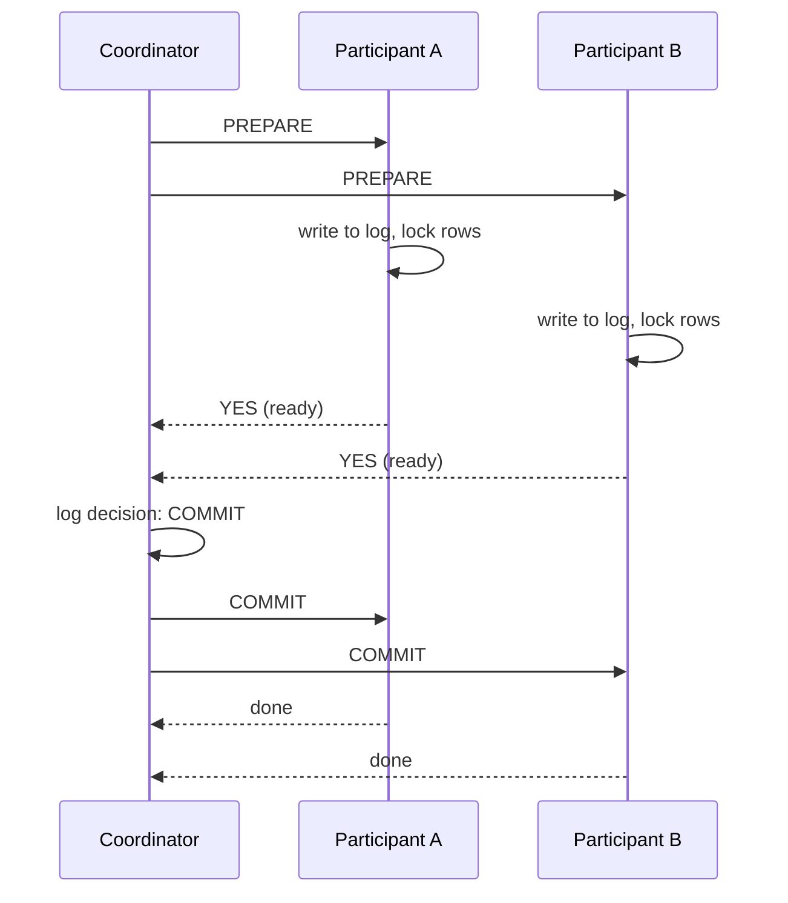
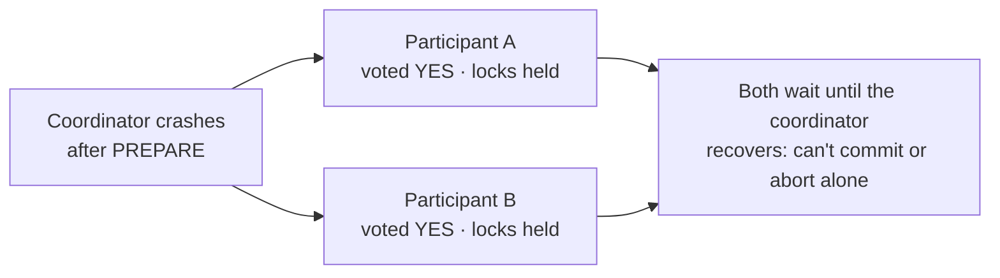

Two-phase commit is a protocol that makes a transaction **atomic across multiple nodes**: either every participant commits, or every participant rolls back.

A **coordinator** runs the protocol, and the databases or services doing the work are the **participants**.

## The two phases

**Phase 1: prepare (voting).** The coordinator asks every participant: "Can you commit?" Each participant does the work, writes it durably to its log, locks the affected rows and votes **yes** or **no**. A yes vote is a promise: "I can commit, no matter what happens next."

**Phase 2: commit or abort.** If **every** participant voted yes, the coordinator logs "commit" and tells everyone to commit. If **anyone** voted no or timed out, it tells everyone to roll back.

## The big weakness: blocking

Once a participant votes yes, it **must wait** for the coordinator's decision, holding its locks the whole time. If the coordinator crashes at that moment:

The participants can't decide on their own: committing might be wrong if someone else voted no, and aborting might be wrong if the coordinator already decided to commit. They stay blocked, with locks held, until the coordinator comes back. Every other transaction touching those rows waits too.

## Other costs

- **Latency:** at least two round trips to every participant, plus durable log writes on each.
- **Locks held across the network** reduce throughput under load.
- **Every participant must be up:** one slow or unavailable node stalls the transaction.

Three-phase commit and consensus-backed coordinators (as in Spanner, which runs 2PC on top of Paxos-replicated groups) reduce the blocking problem, at the cost of more complexity.

## Where 2PC is used

- **Inside distributed databases:** CockroachDB, Spanner and others use 2PC-style commits across shards, with replicated coordinators.
- **XA transactions** across a database and a message broker in traditional enterprise systems.

## Why microservices usually avoid it

At high throughput across independent services, holding locks across the network is too expensive and too fragile. Most cloud systems use the [SAGA pattern](/system-design/distributed-transactions-saga-pattern/) instead, accepting [eventual consistency](/system-design/strong-vs-eventual-consistency/) and compensating actions in exchange for availability.

## In interviews

"2PC gives atomic commits across nodes, but it blocks if the coordinator fails and holds locks across the network. For cross-service checkout I'd use a saga. 2PC belongs inside a distributed database that's built for it."
