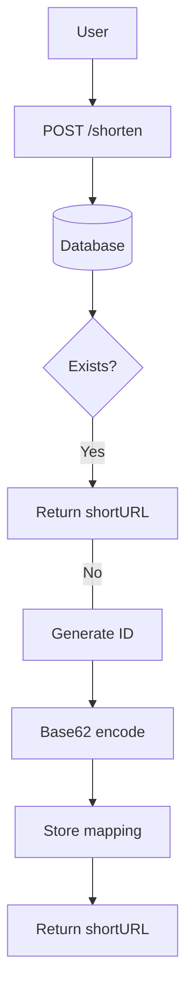
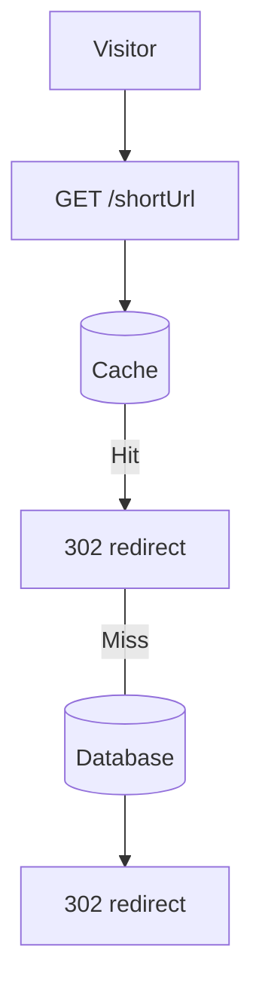

Design a high-scale URL shortening service like TinyURL or Bitly. Covers Base62 encoding, hash collision resolution, 301 vs 302 redirects, DB schema, and edge caching.

*18 min read · Similar: TinyURL, Bitly, Ow.ly, t.co*

## Contents

- 01. Introduction
- 02. Step 1: High-Level Design
- 03. Step 2: Deep Dive into Design
- 04. Additional Considerations

## 1. Introduction

This chapter discusses the design of a URL shortening service like TinyURL. The system's main goals include URL shortening, redirecting, and high scalability to handle large traffic volumes.

### Requirements

- Shortened URLs must be unique and as short as possible.
- Handle 100 million URL generations per day with a 10-year support capacity.
- Support efficient read operations with a 10:1 read-to-write ratio.
- Store 365 billion records, requiring approximately 365 TB of storage over 10 years.

The storage math: $100\text{M} \times 365 \times 10 \approx 3.65 \times 10^{11}$ URLs. At roughly $1\,\text{KB}$ per mapping, total storage lands near $365\,\text{TB}$:

$$100{,}000{,}000 \times 365 \times 10 \times 1\,\text{KB} \approx 365\,\text{TB}$$

## 2. Step 1: High-Level Design

### API Endpoints

**URL Shortening:**

- Endpoint: POST api/v1/data/shorten
- Parameters: {longUrl: longURLString}
- Returns: shortURL

**URL Redirecting:**

- Endpoint: GET api/v1/shortUrl
- Returns: longURL for redirection.

### URL Redirection

- **301 Redirect:** A 301 redirect shows that the requested URL is "permanently" moved to the long URL. The browser caches the response, and subsequent requests for the same URL will not be sent to the URL shortening service.
- **302 Redirect:** Temporary; useful for analytics like tracking clicks.

### URL Shortening

Use a hash function to generate a short URL, mapping long URLs to unique shortened versions. The hash function must satisfy the following requirements:

- Each longURL must be hashed to one hashValue.
- Each hashValue can be mapped back to the longURL.

## 3. Step 2: Deep Dive into Design

### Data Model

Store shortURL to longURL mappings in a relational database to optimize memory usage. The table schema includes: id (primary key), shortURL, longURL.

| Column | Type | Notes |
| --- | --- | --- |
| id | BIGINT PRIMARY KEY | Monotonic unique id |
| shortURL | VARCHAR(16) UNIQUE | Base62-encoded id |
| longURL | TEXT | Original URL |

### Hash Function

**1. Base 62 Conversion:**

Encodes numbers using characters [0-9, a-z, A-Z], providing 62 possible characters. A unique id can be assigned to the short URL and the id can be base 62 converted to get the short URL. A 7-character hash supports up to 3.5 trillion unique URLs, enough for 365 billion URLs:

$$62^7 \approx 3.5 \times 10^{12} > 3.65 \times 10^{11}$$

Example: convert ID 2009215674938 to Base 62 gives `zn9edcu`.

**2. Hash + Collision Resolution:**

Use hash functions like CRC32, MD5, or SHA-1. One approach is to collect the first 7 characters of a hash value; however, this method can lead to hash collisions. To resolve collisions, recursively append a new predefined string until no more collision but this can be expensive. Resolve collisions with Bloom Filters for efficient lookup.

### URL Lookup Comparison

| Hash + Collision Resolution | Base 62 Conversion |
| --- | --- |
| Fixed short URL length | Length grows with ID |
| Does not need a unique ID generator | Needs a unique ID generator |
| Collisions possible, need resolution | Collisions not possible |
| Cannot find the next available short URL | Easy to find the next short URL if ID increments by 1 (can be a security concern) |

### URL Shortening Flow

- Check if longURL exists in the database.
- If found, return the existing shortURL.
- Otherwise: generate a unique ID using a distributed ID generator, convert the ID to shortURL using Base 62, store the mapping in the database.

### URL Redirecting Flow

- User clicks a shortURL.
- Query the shortURL to longURL mapping: check the cache first for faster access.
- If not in the cache, query the database.
- Redirect the user to longURL.

## 4. Additional Considerations

### Rate Limiter

Prevent abuse by setting limits on requests per IP.

### Scalability

- **Web Tier:** Stateless, scalable by adding or removing web servers.
- **Database Tier:** Use replication and sharding.

### Analytics

Collect data like click rates, source, and timestamps for business insights.

### High Availability and Reliability

Ensure consistent and reliable services using database replication and fault-tolerant design.

