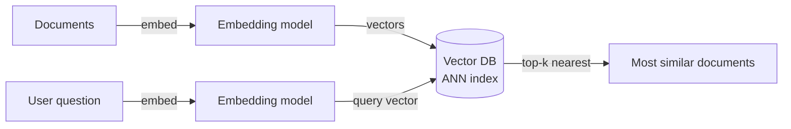

A vector database stores and queries **vectors**: lists of numbers that represent the meaning of text, images, audio or user behaviour. Instead of asking "which rows equal X?", you ask **"which items are most similar to this one?"**

## Where vectors come from

An **embedding model** turns content into a vector, often 384 to 3,072 numbers long. Similar meanings land close together in that space:

- "How do I reset my password?" and "I forgot my login" end up near each other.
- "Reset my router" ends up somewhere else, even though it shares the word "reset."

That's what makes semantic search work: matching on meaning, not keywords.

## How similarity is measured

Two common metrics:

- **Cosine similarity:** the angle between vectors, ignoring their length.

$$\text{cos}(A, B) = \frac{A \cdot B}{\|A\|\,\|B\|}$$

- **Euclidean distance:** the straight-line distance between points.

Many systems also use dot product, which equals cosine similarity when vectors are normalized.

## The search flow

## Why a special database

Comparing a query against every stored vector is exact but slow, because it's linear in the size of the dataset. Vector databases use **approximate nearest neighbour (ANN)** indexes that return *nearly* the best matches in milliseconds over millions or billions of vectors:

- **HNSW:** a layered graph you navigate greedily towards the query. Fast and accurate, memory hungry.
- **IVF:** cluster the vectors, then only search the closest clusters.
- **Product quantization:** compress vectors to save memory, at some cost to accuracy.

The trade-off is **recall versus speed and memory**: you accept occasionally missing a true neighbour in exchange for huge speedups.

They also add database features: metadata filters ("similar products, but only in stock and under ₹2,000"), updates and deletes, replication and sharding.

## Where they're used

- **RAG (retrieval-augmented generation):** fetch the most relevant chunks of your docs and give them to an LLM so it answers from your data.
- **Semantic search** over docs, tickets and code.
- **Recommendations:** "users who liked this also liked..."
- **Image and audio similarity,** duplicate and near-duplicate detection.

## Options

Dedicated: Pinecone, Weaviate, Milvus, Qdrant, Chroma. Extensions: **pgvector** for PostgreSQL, plus vector search in Elasticsearch, OpenSearch, Redis and MongoDB. For many apps, pgvector inside an existing Postgres is enough. See [polyglot persistence](/system-design/polyglot-persistence/).

## In interviews

It's enough to know that vector databases support nearest-neighbour search over high-dimensional embeddings, and that ANN indexes trade a little accuracy for speed. For an AI assistant: "Docs are chunked and embedded into a vector store. At query time we retrieve the top-k chunks and pass them to the model."
