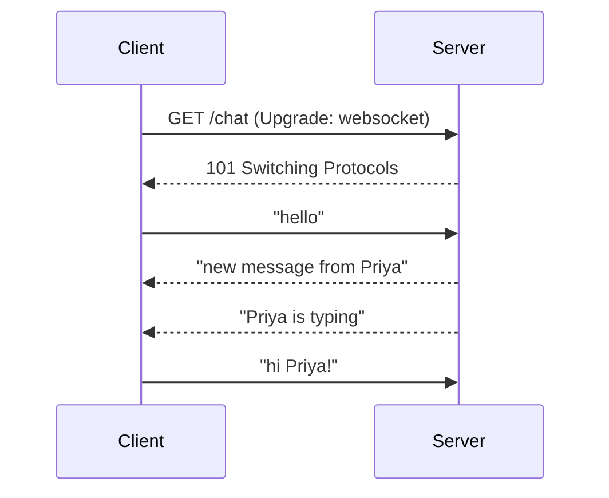
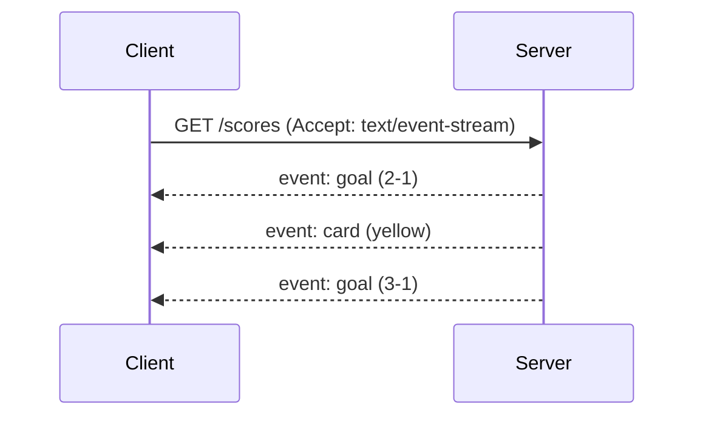

Plain HTTP is request and response: the client asks, the server answers, done. Real-time features (chat, live scores, notifications, collaborative editing) need the server to send data **whenever something happens**. WebSockets and SSE both solve this.

## WebSockets: full duplex

A WebSocket starts as an HTTP request that asks to **upgrade** the connection. After that, the same TCP connection stays open, and either side can send messages at any time.

Great for:

- chat and messaging
- multiplayer games
- live collaboration (shared docs, whiteboards)
- trading screens where the client also sends frequent updates

## SSE: one-way server push

Server-Sent Events use a normal HTTP response that **never ends**. The server keeps writing events in a simple text format, and the browser's built-in `EventSource` API reads them and reconnects automatically if the connection drops.

Great for:

- live scores and dashboards
- notifications and activity feeds
- streaming AI responses token by token
- progress updates for long-running jobs

## Comparison

| | WebSocket | SSE |
| --- | --- | --- |
| Direction | Both ways | Server to client |
| Protocol | Upgraded from HTTP, own framing | Plain HTTP |
| Data | Text or binary | Text only |
| Auto-reconnect | You build it | Built into `EventSource` |
| Proxies and firewalls | Occasionally blocked | Works like any HTTP response |
| Complexity | Higher | Lower |

## Scaling considerations

Both keep a long-lived connection per client, so servers become [stateful](/system-design/stateful-vs-stateless-architecture/) in terms of connections:

- Size servers for **concurrent connections**, not requests per second.
- Use [load balancing](/system-design/load-balancing-algorithms/) that understands long-lived connections, such as least connections.
- When a message must reach a user connected to another server, fan it out through [pub/sub](/system-design/pub-sub-publish-subscribe/), for example with Redis.

## Choosing

If only the server needs to push, start with **SSE**. It's simpler and plain HTTP. Choose **WebSockets** when the client also sends frequent messages. If neither is available, fall back to [long polling](/system-design/long-polling-and-short-polling/).

## In interviews

For a chat system: "Clients hold a WebSocket to a gateway tier. Messages are fanned out across gateway servers with pub/sub, and offline users get push notifications instead."
