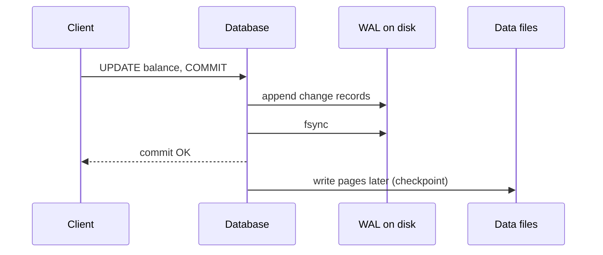
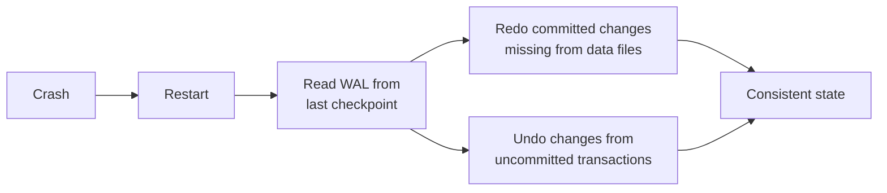

Write-ahead logging follows one rule: **record every change in an append-only log, and make the log durable, before applying the change to the main data files.**

## Why it's needed

Updating a database page in place is risky. A crash halfway through can leave a page half-written, or a transaction that changed three pages with only two written. Without a log, there's no way to know what was supposed to happen, and the data is corrupt.

## How it works

1. The change is appended to the WAL. Appends are sequential, which is fast even on spinning disks.
2. The log is flushed to disk (`fsync`). Only now is the commit acknowledged.
3. The actual data pages are updated later, in batches, during a **checkpoint**.

Committing only requires a fast sequential log write, not many random page writes.

## Crash recovery

After a crash, the database reads the log from the last checkpoint:

- **Redo** committed transactions whose pages never reached disk, giving **durability**.
- **Undo** (or ignore) transactions that never committed, giving **atomicity**.

This is how the A and D of [ACID](/system-design/acid-vs-base/) are actually implemented.

## Bonus uses

- **Replication:** stream the WAL to replicas and replay it there. PostgreSQL streaming replication works this way. See [replication patterns](/system-design/replication-patterns-master-slave-master-master/).
- **Point-in-time recovery:** a base backup plus archived WAL lets you restore to any moment, such as just before someone ran a bad `DELETE`.
- **Change data capture (CDC):** tools like Debezium read the log to publish database changes as events.

## The same idea everywhere

- **LSM trees** write to a WAL before the memtable. See [database indexing](/system-design/database-indexing-b-trees-lsm-trees/).
- **Kafka** is essentially a distributed, replicated log.
- **Consensus algorithms** like [Raft](/system-design/leader-election-paxos-raft/) replicate a log of commands.
- **Filesystems** use journaling, which is the same technique.

## In interviews

When asked how a database survives a crash, or how replicas stay in sync, the answer is the WAL: "Changes are durably appended to the log before being applied. Recovery replays it, and replicas consume the same stream."
